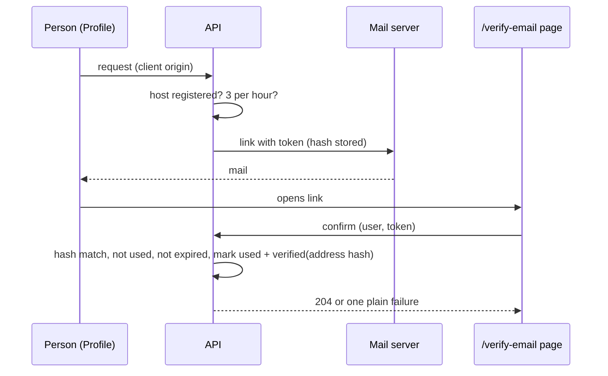

# Stage review: e-mail address verification (password recovery, step 2)

Date: 2026-11-23. Branch `claude-session-2026-12-11` in the Foundation and the app repo, committed, not pushed or deployed. Not seen in a browser; the mail has never gone through a real server.

## What was built

A person proves the address saved on their profile. The server mails a single-use link; opening it marks that address verified. Forgot-my-password (step 3) will only ever use a verified address.

- **Rules** (`EmailVerificationService`, `Adventures.Entities.Identity`): token of 32 random bytes, stored only as a SHA-256 hash, bound to the address it was sent to, valid 24 hours, usable once, at most three mails an hour per person. A verified statement names the address, so a changed address is simply not verified; nothing needs clearing.
- **Store** (`NQuadEmailVerificationStore`): append-only statements in their own graph, outside the tenant graphs and the entity types, so no screen can write them.
- **Mail** (`Mailer` is now an `IEmailSender`): uses the E-mail plug-in settings; refuses when mail is off or incomplete, never echoes server text.
- **Endpoints** (`EmailVerificationController`, `api/email-verification`): status and request need sign-in; confirm is anonymous and answers every failure the same way. The request mails only the saved address, and the link host must be a registered tenant host (localhost only in Development).
- **Client:** Profile section with state and a send button (icon, keyed text), the `/verify-email` page, `EmailVerificationService` in `@adventures/core`.

## Threats covered (tests)

Token theft from the store (only hashes), replay (single use), expiry, another person's token, a token for a different address, mail bombing (3 an hour), mail relay to an arbitrary address (only the saved address), phishing link through our mail (host allow-list), reason leaks (one failure text).

## Verified

Foundation: new service tests (9 cases) and controller tests (11), the architecture guard, every suite passes. App: route-rights guard lists the controller with its reason, host tests build every controller, all suites pass. Client: all five libraries and the app pass; production build 742 kB initial.

## Not verified / open

- Never sent through a real mail server: the E-mail settings (A6) must work first.
- The Users screen does not show the verified state yet (Profile only).
- Next: step 3, "Forgot my password" for verified addresses; the address change by a person after verifying does not notify the old address.
