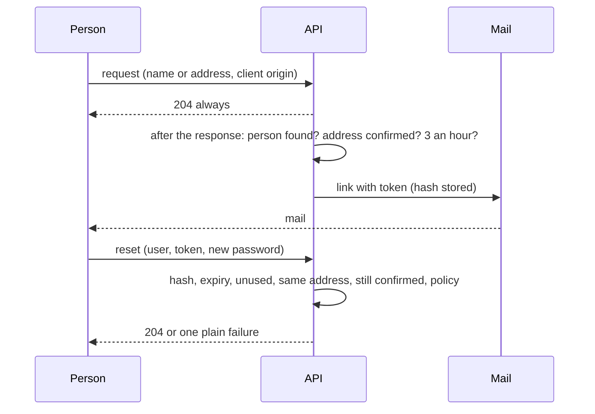

# Stage review: Forgot my password (password recovery, step 3)

Date: 2026-11-23. Branch `claude-session-2026-12-11` in the Foundation and the app repo, committed, not pushed or deployed. Not seen in a browser; the reset mail has not been sent through the real mail server yet (the human proved the E-mail settings and a test send the same day).

## What was built

A person who lost the password asks for a link from the sign-in page. A link is mailed only to an address they have already confirmed (the verification cycle of the earlier stage). Opening it lets them choose a new password.

- **Asking is silent** (`PasswordResetController` `POST api/password-reset/request`): always 204, whatever the name or address, whether it is confirmed, rate limited, or the mail fails. The work runs after the response is complete, so neither the answer nor its timing shows whether the person exists.
- **The link:** token of 32 random bytes, stored only as a SHA-256 hash, valid one hour, usable once, tied to the address it was mailed to, at most three mails an hour per person. The link host must be a registered tenant host (or localhost in Development); the same check now lives in `ClientLinkBase` for both mail flows.
- **Choosing the password** (`POST api/password-reset/reset`): the token, the person and the address must still match, and the address must still be confirmed; a changed address kills the link. The new password follows the same policy as a password change (at least 12 characters). Every bad link gets one plain failure text; a weak password (only reachable with a good link) gets the policy text and the link keeps working.
- **Effect** (`IPasswordResetter` on `UserAccountService`): replaces the hash, clears the lockout and the "must change" flags, does not force another change. A missing or disabled account is refused.
- **Other hosts:** Legacy and developer sign-in hosts register `NoPasswordResetter`, so a reset there ends as an invalid link.
- **Client:** Forgot my password link on the sign-in page, `/forgot-password` and `/reset-password` pages (icon buttons with keyed text).

## Threats covered (tests)

Account enumeration (same answer, work after the response), takeover through an unconfirmed address, token theft from the store (hash only), replay, expiry, another person's token, a verification token used as a reset token, a link that outlives an address change, mail bombing (3 an hour), a foreign link host, reason leaks (one failure text), a weak password.

## Verified

Foundation: reset service 14 cases, controller 6, account store 4, every suite and the architecture guard pass. App: route-rights guard lists the controller with its reason, host tests build every controller in every mode, all suites pass. Client: all libraries and the app pass; production build 743 kB initial.

## Not verified / open

- Not seen in a browser; the reset mail has not gone through the real server (steps A18).
- A shared address (two people with the same e-mail) is refused for the by-address lookup (the person must type the user name).
- There is no per-address or per-network limit on asking beyond three mails an hour per person; mail from the asker's network is not limited.
- The Users screen does not show the confirmed state yet.
