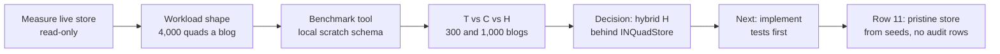

# Stage review: quad storage, measurement and decision (beta row 9, steps 1 to 4)

Date: 2026-11-23. Branch `claude-session-2026-12-11`, committed, not pushed. Nothing in the app or the live store changed; this stage measured and decided. The next stage (implementation) waits for the human's review of `docs/Claude-decision-2026-11-quad-storage.md`.

## What was done

- **Measured the live store (read-only):** per kind of record and per blog (plan section 4c). Main finding: 85% of the rows (102,640 of 120,521) are dead audit records of a feature removed on 2026-10-29.
- **Built `docs/Claude-quad-bench`** (workspace root): synthetic blogs shaped from those numbers, loaded into three layouts in a scratch schema of the local database only (T today, C full dictionary, H hybrid), measured for size, load and index time, p50 and p95 for the six shapes the store answers, and the write path.
- **Ran it at 300 and 1,000 blogs** (1.2 and 4.0 million quads) and **decided: the hybrid layout H** (decision file).

## Headline numbers (1,000 blogs)

| | T today | H hybrid |
|---|---|---|
| Bytes per quad | 841 | 511 (1.64 times smaller; 2.1 times without the body text) |
| List a tenant's posts | 9.84 ms | 1.22 ms |
| Count every post | 354.87 ms | 8.24 ms |
| Write one post (no cache) | 2.89 ms | 1.66 ms |
| Export a tenant graph, SQL expands terms / ids only | 8.98 / 8.98 ms | 47.54 / 4.14 ms |

## Verified

The tool runs end to end at three sizes; a clean rerun with `VACUUM` before measuring replaced a first run whose one H figure was a missing-vacuum artifact (the clean numbers are the ones used). The sizes and ratios in the decision were recomputed from the printed bytes. The tool refuses any non-local host and only touches the schema `quadbench`.

## Not verified / open

- Synthetic data on the local machine; the ratio between layouts is what counts. A run on a second hosted database of the plan (human creates it) is still to do.
- The 1000 MB quota still holds only about 470 blogs of this shape with H (290 today); real post text compresses better than my random words, to be measured.
- Not started: the implementation, the tool updates, the pristine store (row 11), the schema site (row 10).

## Needs the human

Three decisions, recommended answers first, in the decision file ("Decisions for the human"); unanswered counts as agreed per the standing rule, but this is a data-layout change, so I stopped here for review before building it.
