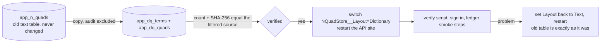

# Stage review: the tools for the dictionary layout, the cutover copy and the pristine store (beta rows 9 and 11)

Date: 2026-11-23. Branch `claude-session-2026-12-11` in the workspace root and the app repo, committed, not pushed or deployed. Nothing on the live site or the live database was touched; the rehearsal ran on the local dev database in scratch tables, now dropped.

## What was built

- **`Claude-nquad-tool`** (workspace root) speaks both layouts. `-Layout Dictionary [-Prefix app_dq]` makes `export`, `restore` and `grant` run through the store class on the dictionary layout; the file format is unchanged and an export sorted by id gives **the same SHA-256 for the same rows from either layout**. `relabel` stays text-only (it was a one-time move). `-NoSsl` (localhost only) lets it run against a local database.
- **`copy -To <prefix> [-From app_n_quads] [-KeepAudit] [-Apply]`**, the cutover copy: reads the text table, drops the dead audit records by default, copies in batches into an EMPTY dictionary store, then proves the copy (row count and SHA-256 over the sorted rows equal the filtered source). Dry run by default: it creates nothing and prints rows per graph. The source is only ever read.
- **`Claude-quad-bench size` and `scratch`**: read the size of a text table; report and drop a scratch dictionary store.
- **`docs/Claude-cutover-quad-layout.md`**: the runbook (carry the content over, or start pristine), the quiet window, the rollback and what the rehearsal proved.

## Verified (rehearsal on the local dev store)

- Dry run, copy with and without the audit rows, an export from the text table, one from the dictionary copy and one from a restored dictionary store: **identical SHA-256 (`68AD5591...`) for all three**; both refusals (copy or restore into a non-empty store) fire.
- Size on real data: 616 bytes a row (text) against 327 (dictionary), 1.88 times smaller.
- The real API started on the copied store and on an empty store with the install seed. The pristine store holds 1,449 rows (schemas and defaults): no account names, no audit rows.
- No suite changed in this stage (the tool has no test project; the rehearsal is its test); the last full runs of the Foundation and app suites, earlier today, pass.

## Not verified / open

- **Not run on the hosted database.** The live cutover (the copy with `-Apply`, the setting, the restart) needs the human's go and a quiet window.
- **`grant` on the dictionary layout** is written and builds but was not run (the local store has no person to grant); its dry run is the first thing to try after a cutover.
- The API comparison on the dev store was nearly empty (no published posts in the new format there); content equality rests on the matching hashes.
- **A side effect to know:** starting the real API in Development on the local text table applied 187 pending named-seed quads to the human's local `app_n_quads` (as any development start does); the copy then carried them, and nothing else local was changed.
- The second hosted database for the benchmark on the shared host (human creates it) is still open; so are the concurrency stress test of two writers, a restore rehearsal from the hosting panel and the schema site (row 10).

## Needs the human

The choice between route A (carry the content over) and route B (pristine start) for the live site, and the "go" for the quiet window. Recommended: A for the live site (it holds the human's content), B for any fresh install.
