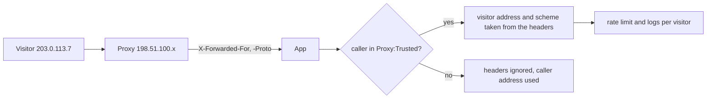

# Stage review: running behind a CDN or reverse proxy

Date: 2026-11-23. Branch `claude-session-2026-12-11` in the Foundation and the app repo, committed, not pushed or deployed. Not run behind a real proxy yet.

## The problem

Behind a proxy the app sees the proxy's address for every visitor: every per-address limit (sign-in, comments, search, health) would be shared by all visitors, the logs could not tell visitors apart, and the https redirect loops when the proxy speaks plain http to the app.

## What was built

- **`Proxy:Trusted`** (`TrustedProxies`, `Adventures.WebApi/Hardening`): the proxy addresses or ranges (CIDR), as a list or one comma-separated value (an environment variable gives that). Empty by default, which turns the feature off entirely.
- **Only listed proxies are believed:** when the immediate caller is on the list, the visitor address (`X-Forwarded-For`) and the scheme (`X-Forwarded-Proto`) are taken from the headers; a header from anyone else is ignored, so nobody can choose their own address and dodge a limit or fake https.
- **The forwarded host is never used:** the tenant is still decided from the host the server saw (T1 rule).
- **`Proxy:ForwardLimit`** (default 1): how many proxies in a row are believed, from the app; with 1 only the last address counts, so a faked first entry changes nothing.
- **Fails safe both ways:** a bad entry stops the start naming the setting (ignoring it would trust nothing, widening it would trust everyone); and the options never reach the middleware with empty lists, which ASP.NET reads as "trust everyone" (a test found this; an unreachable sentinel address is listed then).
- **`HttpRequestOrigin`** (the check that gates the developer sign-in) also treats the `X-Original-For` trace the middleware leaves as "came through a proxy", so a proxy on the same machine can never make a visitor look local.
- **Wired first in all three hosts** (API, MCP server, NQuad browser); the rate limiter now partitions by the visitor, the https redirect sees https.
- **Install guide:** a new section on fronting with a CDN, including how to choose the ranges.

## Verified

Foundation: 14 new cases through the real forwarded-headers middleware built from the same options (spoofed header from a non-proxy ignored, off by default, ranges, comma list, faked first entry, forwarded host unused, bad entries, two visitors get separate rate windows, proxy trace is never local); every Foundation suite and all app suites pass.

## Not verified / open

- Never run behind a real CDN: steps A19 do it locally with curl, then live once a CDN is fronted.
- Each request log line now ends with the client address (`from <address>`); that is a log change with no automated test, and it keeps visitor addresses in the 14-day log files, so mention it in any privacy text.
- The host tests do not start a host with the setting on (the unit tests cover the options and the middleware, not the pipeline order).
- Keeping a CDN's published ranges current is the installer's job (documented).
