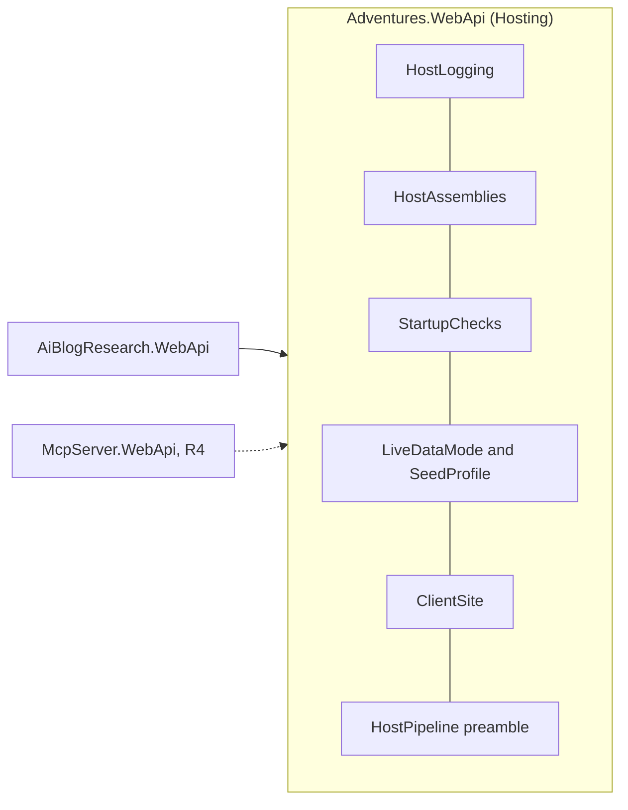

# Stage review: R1 shared hosting (host reuse review, 2026-11-24)

**What was built.** The generic startup pieces of the API host moved into `Adventures.WebApi` (Foundation, folder `Hosting`), so a second host reuses them instead of copying them. Behaviour is unchanged; every moved class kept its tests, which moved with it.

| Moved from the API host | Now in `Adventures.WebApi` | Parameter that replaced a hard-coded name |
|---|---|---|
| `AppLogging.UseAppSerilog` | `HostLogging.UseAdventuresSerilog` | log file prefix (default `webapi`) |
| `AppAssemblies` | `HostAssemblies.EnsureReferencedLoaded(assembly)`, `Libraries(prefixes)` | the host assembly and the name prefixes (was `AiBlogResearch`) |
| `StartupChecks`, `StartupProblem` | same names | `FindMissingSchemas` takes triples, so WebApi still references no store (guard test) |
| `LiveDataMode`, `SeedProfile` | same names | none |
| `ClientSite` | same name | none |
| front half of `AppPipeline` | `HostPipeline.UseAdventuresPreamble(corsPolicy)` | the CORS policy name |

`AppPipeline` in the API host went from 109 to 67 lines; the five startup files and three test files are gone from it.

**Verified.** Tests first (the three moved test files and a new `ClientSiteTests` failed to compile until the code moved). Then: Foundation full suite passes (including the architecture guards), app API tests 55, host tests 51 (they cover single-site mode, Legacy mode and the live pipeline end to end), MCP tests 105. **Not yet:** a live `Claude-verify.ps1` (nothing is deployed from this branch) and a run in a browser.

**Not in R1 (moved to R4 on purpose).** The service-client helper (API to MCP and MCP to API HTTP clients) has one user until the MCP host is rebuilt on the shared host; adding it then avoids a helper nothing else calls. The remaining R1 item, the host's own composition lists, belong to R2 to R3.

**Blog post:** none; this is a mechanical move whose commit messages explain it.
