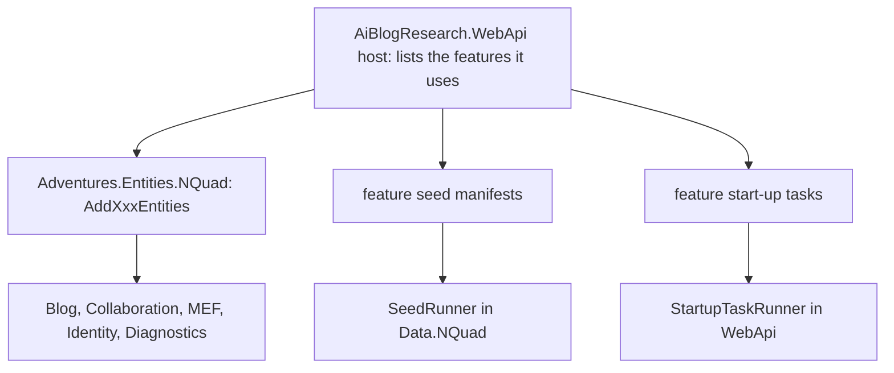

# Stage review: R2 features own their registrations (host reuse review, 2026-11-24)

**What was built.** The three lists a second host would have copied no longer sit in the API host: the seed list, the entity repository registrations and the start-up upgrades. Each feature library now declares its own, and the host only names which features it uses.

| Was in the API host | Now | Where |
|---|---|---|
| `StartupSeeds` (27 named seeds in order) | one manifest per feature (`DiagnosticsSeeds`, `IdentitySeeds`, `BlogSeeds`, `LegacySeeds`, `CollaborationSeeds`, `PluginSeeds`) and one generic `SeedRunner` | manifests beside the seed files; `SeedEntry` in `Adventures.Entities`, `SeedRunner` in `Adventures.Data.NQuad` |
| about 90 lines of `AddNQuadEntityRepository` in `AppEntityServices` | `AddCoreEntities`, `AddDiagnosticsEntities`, `AddIdentityEntities`, `AddBlogEntities`, `AddCollaborationEntities`, `AddPluginEntities` | new project `Adventures.Entities.NQuad` (the composition layer between the feature libraries and the store) |
| `AppStartupUpgrades` | `IStartupTask` (in `Adventures.Common`), contributed by the features, run by `StartupTaskRunner` | `RoleRightsStartupTask` and `PlatformAdministratorStartupTask` in `Adventures.Entities.Identity`; `IdentitySchemaStartupTask` in `Adventures.Data.Postgres` |

`AppEntityServices` went from 165 to 88 lines. What remains in it is tenancy, rights, mail and service wiring, which moves in R3 and R4 with the menu and gateway work.

**Why a new project.** The feature libraries must not reference the store (guard tests), and `Adventures.Data.NQuad` cannot reference the features, so something above both has to hold the registrations. `Adventures.Entities.NQuad` is that layer; the architecture guards record its seven references and name it as the only extra referrer of Blog and Collaboration.

**Seed order.** The seeds now apply grouped by feature, not in the old interleaved order. A fresh in-memory store seeded the old way and the new way holds exactly the same data: 1,501 quads, identical SHA-256 over predicate, object and graph (the timestamps of the seed markers, the supersede stamps and the platform-administrator quad were left out of the hash because they differ on every run). Existing stores are unaffected: a named seed applies once.

**Guards added.** `SeedManifestTests` fails when a seed file in a feature library is not in its manifest, when a listed file is missing, or when a seed name or file repeats. `seed-012-legacy-wave2.nq` exists but no host applies it today; it is the one listed exception and is a question for you (apply it, or delete it).

**Behaviour kept on purpose.** The identity schema task is skipped in Legacy mode and its failure is logged and ignored (a host without the right to create tables, or with no connection string, still starts); the role-rights upgrade and first platform administrator still stop start-up if they fail; live data mode that skips seeding skips all start-up tasks, as before.

**Verified.** Foundation full suite (architecture guards included), app API 55, host 51, MCP 105, NQuad browser 13. One real bug was caught by the host tests along the way: resolving the schema task eagerly made a host with no Postgres connection fail instead of carrying on; the initializer is now resolved inside the task. Not verified: a live start against the production store and `Claude-verify.ps1` (nothing is deployed from this branch). I wrote the start-up task runner tests and the code in one step, so there was no red run for those four tests.

**Not in R2.** The MCP host and the NQuad browser host do not use the manifests or tasks yet (R4); the service-client helper waits for R4.
