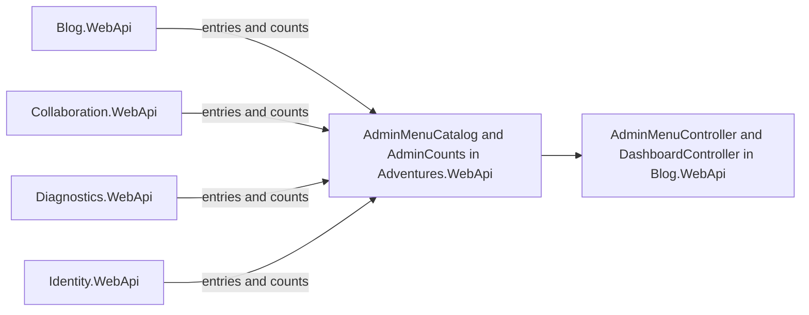

# Stage review: R3 admin menu, dashboard and counts as feature contributions (host reuse review, 2026-11-24)

**What was built.** The admin menu, its badges and the dashboard no longer live in the API host. Each feature library declares the entries of the screens it owns and the counts it can show; one controller in Foundation assembles them.

| Was in the API host | Now |
|---|---|
| `AdminMenuDefinitions` (18 entries, one list) | each library contributes its own through `AddAdminMenuItems`: Blog (dashboard, posts, pages, categories, tags, comments, settings, e-mail, maintenance, widgets, languages), Collaboration (collaboration, decisions, plugins), Diagnostics (exceptions), Identity (users, roles, tenants) |
| plug-in gating by a host dictionary (`ContributedBy`) | the entry names its plug-ins (`AnyOfPlugins`) |
| badges computed in `AdminMenuController` (exceptions, posts, collaboration, comments) | `IAdminCountSource` per feature, collected by `AdminCounts` |
| `ReviewQueue` | `PostsNeedingReviewCount` (Blog.WebApi) and `CollaborationWaitingCount` (Collaboration.WebApi) |
| `AdminMenuController` | Foundation `Adventures.Blog.WebApi` (it needs the site language), with the menu names declared as server text through the new `IServerTextSource` |
| `DashboardController`, `DashboardSummary`, Quick draft | `Adventures.Blog.WebApi`; the dashboard asks `AdminCounts` for the exception, collaboration and comment figures instead of calling three features directly |

The API host's `Controllers` folder now holds one controller (`RuntimeController`, the live-data banner fact).

**Cost per call, fixed.** The menu used to page through every post with drafts and list every collaboration item on each load. Counts are now remembered for five seconds per tenant, so a menu load and a dashboard load in the same moment share one answer. Five seconds is short on purpose: the client refreshes the badge right after an approval, and a longer wait would show a stale number. **Known limit:** a refresh within the five seconds after an approval can still show the old count; an explicit refresh after the approval (cache invalidation on the moderation actions) is a small follow-up if you notice it.

**Section order** is now a rule (Dashboard, Content, Users, System, then any other in the order contributed) instead of the accident of one list, so features can contribute in any order.

**Verified.** Tests first for the framework (`AdminMenuContributionTests`: section order, plug-in gating, duplicate ids refused, count caching per tenant). The composed menu equals the old one entry for entry (a new app test pins the four sections and their items in order, with the platform right held). Foundation full suite, app API 56, host 51, MCP 100, NQuad browser 13, LegacyImport 16 pass. Not verified: the screens in a browser (the menu badges, dashboard figures) and a live `Claude-verify.ps1`.

**Not in R3.** The menu tests stay in the app's test project (they compose the same libraries the host lists); moving them next to a Foundation project that references all four libraries is a tidy-up for R6.
