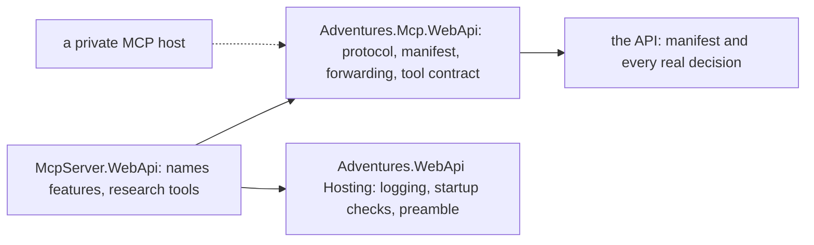

# Stage review: R4 the MCP gateway library and an observable MCP host (host reuse review, 2026-11-24)

**What was built.** The MCP protocol gateway left the app project and became a Foundation library, `Adventures.Mcp.WebApi`; the MCP host was rebuilt on the shared hosting from R1, so it gained what the API host already had. A private MCP server now reuses the gateway instead of copying 273 lines of protocol code.

| Was in `McpServer.WebApi` | Now |
|---|---|
| `McpController` (JSON-RPC, manifest cache, scope granting, forwarding) | `Adventures.Mcp.WebApi`, driven by `McpGatewayOptions` (server name, version, instructions, extra scopes, default API address) |
| `DiagnosticsApiClient` (forwards anything) | `ApiForwardingClient` in the gateway |
| `IMcpOnlyTool`, `McpOnlyToolRegistry`, `McpToolOutcome` | the gateway library; the host's `ResearchTools` implement them |
| `HelloController`, `HealthController` | the gateway (`McpHealthController`, same routes) |
| `DiagnosticsController` (REST proxy, three routes, already lagging the manifest) | **removed**; `docs/Claude-diagnose.ps1` now calls the MCP endpoint (`tools/call`) |
| `Program.cs` 75 lines, its own pipeline copy | `Program.cs` names the features; pipeline is `UseAdventuresPreamble`, logging is `UseAdventuresSerilog("mcp")` |
| scope strings `"content.draft"`, `"mcp.diagnostics.read"`, `"mcp.hello"` in several places | `Adventures.Security.Scopes` (the Foundation controllers use the constants too) |
| two API scope policies nothing used (`mcp.postgres.query`, `mcp.filesearch.search`) | no longer registered as policies (the demo clients in `appsettings.json` still list them; harmless, a config cleanup if you want it) |
| two copies of the outgoing client recipe (API to MCP, MCP to API) | `ServiceClients.AddServiceClient` (base address, timeout, correlation id, optional no-retry) |

**What the MCP host gained (the drift the review found).** Proved by running the host as a real process: it now writes `logs/mcp-*.log` and the JSON sibling, every response carries `X-Correlation-Id` and the security headers, an anonymous call to `/mcp` is 401, and the root answers 200 over plain http. It also gets the one shared exception handler, the rate limiter (it registered the hardening but never used it), and a readable 503 "reporting app" when `Jwt:SigningKey` is missing (`StartupChecks.Find(..., needsDatabase: false)`). Not gained: recording exceptions in the exception log, because this host has no database of its own (it asks the API); its failures are in its own log file with the correlation id.

**Verified.** Foundation full suite (architecture guards updated for the new project and its edges), app API 55, host 51, MCP 100, NQuad browser 13, LegacyImport 16. New Foundation tests: `GatewayContractTests` (scope names pinned, registry rules) and a `StartupChecks` test for a host with no database (red first, then green). Not verified: the MCP host on the live site, a Claude Code connector against the rebuilt gateway, and `Claude-diagnose.ps1` against production (it was rewritten, not run, because nothing is deployed).

**Deploy order matters.** The old REST routes on the MCP site disappear with the MCP deploy, so deploy the MCP site and use the new `Claude-diagnose.ps1` together; the API needs no change for this stage.

**Also done.** `seed-012-legacy-wave2.nq` deleted at your word (no host applied it); the generator test that compared it and the loader test that read it were trimmed to the wave 1 seeds. The generator itself stays (the legacy import tool and the id seed use it); it moves in R5.

**Not in R4.** Moving the generator and the research tools into an optional module (R5); a `ServiceClients` use for the gateway's API client is done, the diagnostics probe in the API still builds its own.
