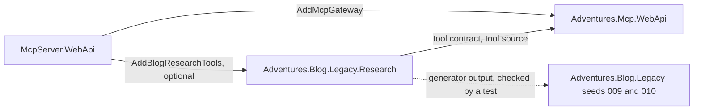

# Stage review: R5 the legacy research module (host reuse review, 2026-11-24)

**What was built.** The BlogEngine.NET research tools are an optional Foundation module, `Adventures.Blog.Legacy.Research`, instead of code inside the MCP host. A host adds them with one line, `AddBlogResearchTools()`; a host without that line has no SQL Server code on its path.

| Was in `McpServer.WebApi` | Now in `Adventures.Blog.Legacy.Research` |
|---|---|
| `BlogAiTables`, `BlogAiCatalog` (the one list of legacy tables and the named queries) | `Tables/` |
| `BlogAiReader` (SELECT-only reader, `ConnectionStrings:BlogAi`) | `Reader/` |
| `ResearchTools` (the 20 tools plus the paged rows tool) | `Tools/` |
| `LegacySchemaSeed` (generates the legacy mirror seeds from the table list; the dependency pointed the wrong way: an app project writing a Foundation file) | `Seeds/`; its tests now run in `Adventures.Blog.Legacy.Tests` next to the seed files they compare |

**Gateway change.** The gateway now collects tools from an `IMcpOnlyToolSource` as well as from individually registered tools, and grants the scope of every registered tool from the registry itself, so a module needs no scope list in the host's options. `McpGatewayOptions.AdditionalScopes` stays for a scope with no tool behind it.

**Host.** `McpServer.WebApi` lost `Microsoft.Data.SqlClient` and the Pkcs pin (they live in the module's project file); `Program.cs` calls `AddMcpGateway` and `AddBlogResearchTools`. The tool `LegacyImport` and its tests now reference the module, not the MCP host.

**The one list of tables.** The table list is single (it already was: the row tool and the generated schemas read the same one). What I did not do: merge the research reader with `Adventures.Data.Sql` and `Adventures.Blog.Legacy`. They use two different logins on purpose: the research reader has a SELECT-only login with column-level grants (`ConnectionStrings:BlogAi`), while the legacy mode of the blog (`ConnectionStrings:LegacySql`) reads and writes posts and pages. Merging them would blur that boundary, so the module stays a sibling that references no store project.

**Guards.** The MCP host's guard test now expects no package references in the host, the module as an extra project reference, and a second assertion that the module references only the gateway and the SQL client packages. New `ResearchModuleTests` check that one call adds the tools and that without the call the gateway holds none.

**Verified.** Tests first (red for the module registration and for the tool source, then green). Foundation full suite, app API 56, host 51, MCP 91 (nine seed tests moved to the Foundation), NQuad browser 13, LegacyImport 16 pass; the MCP host started as a real process in Production answers 200 on `/` and 401 on an anonymous `/mcp`. Not verified: the research tools against the live legacy database (needs the `ConnectionStrings:BlogAi` secret) and a live `Claude-verify.ps1`.

**Not in R5.** Nothing deployed. R6 (the thin-host ratchet) is next.
