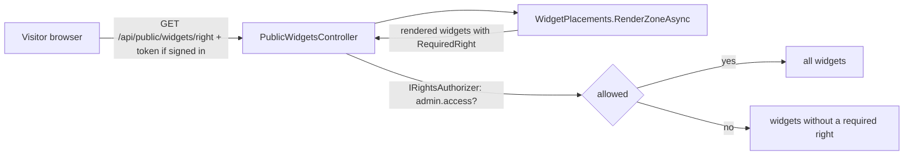

# Stage review: the Administration widget (DCP c62c213c)

**Branch:** `claude-session-2026-12-14` in the app repo and in `Adventures.Foundation`.

## What was built

A built-in widget, **Administration**, like the legacy BlogEngine one: Dashboard, Content, Custom, Users, Settings, Profile, Change password, Log off.

- **Who sees it:** only a caller who holds `admin.access`, the same right that opens the admin area. For everyone else (anonymous visitors included) the public zone endpoint leaves it out, so the links are never sent.
- **How:** `WidgetDefinition` has a new optional `RequiredRight`. `RenderedWidget` carries it (marked `JsonIgnore`, so the right never reaches the browser), and `PublicWidgetsController` filters with `IRightsAuthorizer`. Any future widget can use the same gate.
- **Log off:** the widget links to `/logout`. A new client route `/logout` signs the person out and shows the home page.
- **Placement:** the widget is offered on Admin > Widgets (plug-in `widgets`) and an administrator places it in a zone, as with the other widgets. No placement is created for existing tenants.

## Limits

- The eight links are fixed. Someone with `admin.access` but not, for example, `users.manage` still sees Users and is refused on that screen. (Legacy hid links by role; a per-link right is a later refinement.)
- Seen in no browser yet.

## Verified

- Foundation: `Adventures.Blog.Tests` 366, `Adventures.Blog.WebApi.Tests` 71, `Adventures.MEF.Tests` 33, `Adventures.Architecture.Tests` 23, all pass (new tests written first: the links, the right, the filter for both callers, the right never serialised, the constant equals `Rights.AdminAccess`).
- App: host tests 51 and API tests 70 pass; client app project 55 pass, including the new `/logout` spec.

## Test steps for the human

1. `.\docs\Claude-run.ps1 -Branch claude-session-2026-12-14`, sign in as Admin, open Admin > Widgets, place **Administration** in the right zone.
2. Open the public site: the box lists the eight links. Use Log off: you land on the home page signed out.
3. Reload as a signed-out visitor: the Administration box is gone and the other widgets remain.
