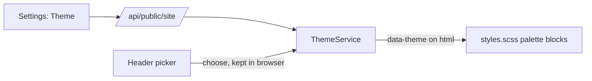

# Stage review: colour themes next to Dark or Light (DCP c62c213c)

**Branch:** `claude-session-2026-12-14` in the app repo and in `Adventures.Foundation`.

## What Angular Material offers

Angular Material 22 ships twelve palettes for its Material 3 theming: azure, blue, chartreuse, cyan, green, magenta, orange, red, rose, spring-green, violet and yellow. The site always used azure (tertiary blue). Each palette works in dark and light.

## What was built

- **A picker in the header**, next to the dark/light toggle: a small drop-down of the twelve names. A visitor's pick is kept in their browser and wins over the site default.
- **A site default:** the new setting `Theme` (Admin > Settings > Basic, "Colour theme"), azure unless set. A name that is not one of the twelve falls back to azure, so a typo or markup cannot reach the page.
- **Same pattern as the colour mode:** the last site default this browser saw is painted at start-up so the page does not flash azure.
- **How the colours switch:** `styles.scss` has one block of Material colours per palette, chosen by `data-theme` on the html element. Azure carries no attribute (it is the theme the site always had), so nothing changes for anyone who does not pick.
- Server: `SiteThemes` (the twelve names, `Normalise`), `PublicSiteSettings.Theme`, and the settings screen creates the `Theme` row where a tenant lacks it. Client: `ThemeService`.

## Cost

The twelve palettes add about 48 kB to the initial bundle (744 kB to 792 kB). That is within the 1.0 MB error budget but over the 600 kB warning line, which the build already reported before this change.

## Verified

- Foundation `Adventures.Blog.Tests` 377 (new tests first: the twelve names, normalisation including a hostile value, the setting row); app host tests 51 and API tests 70; client suites: app 63, admin 174, entity-ui 76, blog-reader 44; the production build succeeds and the generated CSS contains the palette blocks.
- Not seen in a browser: whether every palette looks good with the site's own styles (tag cloud pills, badges) is for you to judge.

## Test steps for the human

1. `.\docs\Claude-run.ps1 -Branch claude-session-2026-12-14`, open the public site.
2. Pick violet in the header drop-down: buttons, links and menus change colour; reload, the pick stays. Toggle dark and light with each theme you try.
3. Admin > Settings > Basic > Colour theme: set `orange` and save. In a private window (no pick yet) the site starts orange.
4. Say which themes you would drop, if any.
