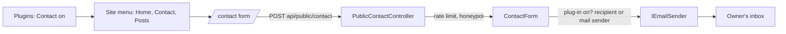

# Stage review: the Contact plug-in (DCP c62c213c)

**Branch:** `claude-session-2026-12-14` in the app repo and in `Adventures.Foundation`.

## What the DCP asked

A Contact plug-in that, if enabled, adds a CONTACT link following Home, so visitors see Home, Contact, Posts, then the configured page list.

## What was built

- **The plug-in `contact`** (Admin > Plugins). It starts **off**: it shows something to every visitor and needs the E-mail plug-in set up. To make that possible `PluginDefinition` has a new `DefaultEnabled` (true for everything that existed, so nothing else changes); the owner's switch wins either way.
- **Settings (Customize screen):** *Send messages to* (an address; empty uses the sender address of the E-mail plug-in) and *Text above the form*.
- **The link:** Contact follows Home and comes before Posts, only while the plug-in is on.
- **The form** at `/contact`: name, e-mail (so the owner can answer), message. It sends the message to the owner by e-mail through the existing mail sender. If the plug-in is off the page says it is not available.
- **Abuse limits** (the same pattern as comments): anonymous endpoint `api/public/contact`, rate limited per client address, 16 kB request cap, hidden honeypot field answered like a real message but sending nothing, name 80 and message 4000 characters, control characters stripped from the name and address so a line break cannot add a mail header. The recipient address is never sent to a browser. If no address can be found to send to, the visitor is told the form is not set up and nothing is sent.

## Limits

- No copy is sent to the visitor, and no message is stored: if the mail server is down the visitor sees a refusal and the message is lost (the same as the comment notices).
- The Reply-To is not set (the mail sender only takes to, subject and body); the visitor's address is in the first line of the body.
- Not seen in a browser, and no real mail was sent (the sender is faked in the tests).

## Verified

- Foundation: `Adventures.Blog.Tests` 391 (new `ContactFormTests`), `Adventures.Blog.WebApi.Tests` 76 (new `ContactControllerTests`), `Adventures.Collaboration.Tests` 23 (new `PluginDefaultStateTests`), MEF 33, MEF.WebApi 21, Collaboration.WebApi 20, Tools.WebApi 9, Architecture 23, Entities 265, all pass.
- App: API tests 70 (the anonymous-route guard now lists the contact endpoint with its reason), host tests 51; client: blog-reader 52 (new contact page and nav specs), entity-ui 76, app 63, admin 174; production build succeeds (initial bundle 796 kB, error budget 1.0 MB).

## Test steps for the human

1. `.\docs\Claude-run.ps1 -Branch claude-session-2026-12-14`. First set up Admin > Plugins > E-mail (sender address and server), then **Contact**: switch it on, Customize, set *Send messages to* (or leave it to use the E-mail sender).
2. Open the public site: the menu shows Home, Contact, Posts. Open Contact, send a message; it arrives in the owner's inbox with the visitor's name and address.
3. Switch Contact off: the link disappears and `/contact` says it is not available.
4. Try an empty field, a bad address, and send three messages in a minute (the third is slowed).
