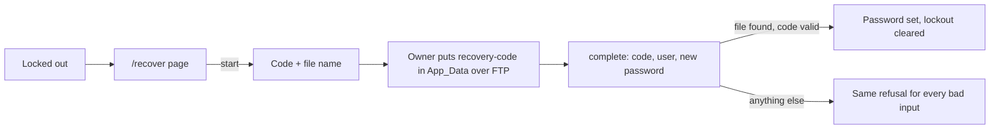

# Stage review: the lockout stage, a guard and recovery with a file (multi-domain decision, stage 1)

**Branch:** `claude-session-2026-12-14` in the app repo and in `Adventures.Foundation`. Decision: [Claude-decision-2026-11-multi-domain-mirror.md](../Claude-decision-2026-11-multi-domain-mirror.md).

## Why

A second installation locked its owner out: the tenant's API alias was cleared from the very address the request came on, so the API recognised no site and every address showed Setup. There was no e-mail to fall back on. Two fixes, in order.

## 1. The guard

`DELETE api/tenant/{id}/aliases/{host}` is refused (409, with the reason) when the host is the address the request arrived on, or a name above it. It has to be done from another address, which proves there is a way back in. `TenantAddressGuard` holds the rule; tests first, including a port, upper case and a subdomain of the alias.

## 2. Recovery without e-mail

The owner proves control of the installation by putting a file on the host, then chooses a new password.

- **Get a code:** `POST api/recovery/start` hands out a 128-bit code (32 hex characters), good for 15 minutes, kept in memory only (a restart forgets it, so a stale file proves nothing), at most 20 pending.
- **Put the file:** an empty file named `recovery-<code>` (or with `.txt`) in the `App_Data` folder next to the app.
- **Finish:** `POST api/recovery/complete` with the code, the site (optional when the address already reaches a site), the user name and the new password. The password is the owner's own choice and is checked against the password policy before the code is used up. The existing resetter sets it, clears the lockout and does not force another change.
- **Where:** a new page `/recover`, linked from the sign-in page and from the setup page of an address that reaches no site. `/api/recovery` is exempt from the unknown-host refusal like `/api/setup`, so it also works there.

### Threats addressed

| Threat | Answer |
|---|---|
| Anyone triggering a reset | Needs a file on the host; only someone who can write there can create it |
| Reset to a known default password | Never: the owner chooses the password |
| Failed sign-ins used to trigger a takeover | Not a trigger at all |
| Guessing the code | 128 bits, 15 minutes, rate limited like sign-in, 20 pending at most |
| A file path built from the request | Only 32 lower-case hex characters are ever used in a path |
| Reuse or a stale file after a restart | Used once (all pending codes are dropped on success); memory only |
| Learning about sites or accounts | Before the proof every bad input gets the same answer; unknown site or account only after the proof |
| Filling memory | Pending codes capped at 20 |

## Limits and not verified

- Not run against a real account store or on the host: the tests use fakes for the resetter and a temporary folder. The first real check is on the second installation after deploy (see test steps).
- The app needs no write access to `App_Data` (it only reads and tries to delete the file); if it cannot make the folder, the page tells the owner to create it.
- Windows or an FTP client may add `.txt`; both names are accepted.
- Not seen in a browser.

## Verified

Foundation: `Adventures.Identity.WebApi.Tests` 207 (new: 26 recovery and guard tests), `Adventures.WebApi.Tests` 249 (recovery path exempt, neighbours not), Architecture 23, Entities 265. App: API tests 70 (the new anonymous controller listed with its reason), host tests 51; client: core 83, admin 179, entity-ui 76, app 66; the production build succeeds.

## Test steps for the human (after the next deploy of the second installation, or locally)

1. Open the sign-in page: the link **Locked out and no e-mail? Recover with a file on the host** is there. Open it, then **Get a code**.
2. Create the empty file named as shown in `App_Data` over FTP. Fill in the form and choose a new password. It should say the password was changed.
3. Sign in with it. Try again with the same code: it must be refused.
4. Try a wrong code, and a code without its file: both give the same refusal.
5. Guard: in Admin > Tenants, try to remove the host name you are on: refused with the reason.
