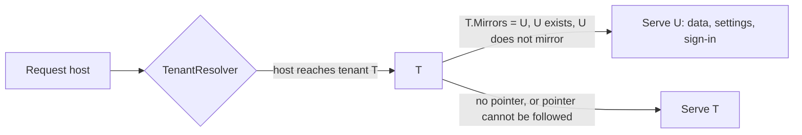

# Stage review: the mirror pointer (multi-domain decision, stage 2)

**Branch:** `claude-session-2026-12-14` in the app repo and in `Adventures.Foundation`. **Merged to `main` and deployed to the live site and the second installation on 2026-11-25** (the human tests it on the second installation). Decision: [Claude-decision-2026-11-multi-domain-mirror.md](../Claude-decision-2026-11-multi-domain-mirror.md).

## What was built

A tenant can use the configuration of another tenant, with a drop-down, and go back to its own with one choice. Nothing of its own is deleted or changed.

- **The pointer lives on the requesting tenant** (a new field `Mirrors`, seed 028). While it is set, every host name of that tenant (its domain, its aliases, names under them) is served from the target tenant's data, settings, widgets and sign-in. The tenant's own record is only ignored.
- **One level only.** A tenant that mirrors cannot be a target, and a tenant that others mirror cannot start to mirror. A pointer to a deleted tenant, to itself, or to a tenant that mirrors is ignored, so the host then serves its own tenant (no chain or loop is ever followed).
- **Admin > Tenants:** each tenant card has "Use the configuration of" with "Its own configuration" and the sites that can be targets, plus Apply. Platform administrators only.
- **A notice on every admin screen** while the address mirrors ("Mirroring <site>: <address> shows that site, and changes made here change it"), and on the Dashboard panel a **Stop mirroring** button. The old alias-based "Make host mirror" control is gone; aliases remain for extra host names of one tenant.
- **The lockout guard for the pointer:** setting a pointer is refused when the request is on the very site it would change (the person's account belongs to that site, so they would be signed out with no way back); do it from the target site's address, or while acting in that tenant. Clearing it is always allowed, from the mirroring address too.
- API: `PUT api/tenant/{id}/mirror` with `{ "target": "<tenant id>" }` or `{ "target": null }`; `api/tenant/current` also names the host's own tenant while mirroring; `api/tenant/hosts` shows each tenant's pointer.

## What mirroring means for people (as decided)

- A mirrored address shows the other site's content and takes the other site's sign-ins; the mirroring tenant's own users cannot sign in there until the pointer is cleared.
- Edits made on a mirrored address change the other site's content.

## Threats addressed

| Threat | Answer |
|---|---|
| A tenant administrator pointing a host at someone else's data | The route needs the platform right |
| Pointer loops and chains | One level; stale ones are ignored, never followed |
| Pointer to something that is not a tenant | Refused; a vanished target is ignored |
| Locking yourself out by mirroring the site you sign in to | Refused from that site's own address; clearing always allowed |
| A token from one site used on a mirrored address | Unchanged check: the token's tenant claim must match the effective tenant, so a person signs in again there |
| Stale caches after a change | The tenant and CORS caches are cleared on every change |

## Not verified

- Not run on a real store or host: the rules are tested on the in-memory store and through the controller with fakes.
- Not seen in a browser.
- CORS for the split layout still depends on which address the API is called on; the single-site layout (stage 3) is the one this is made for.

## Verified

Foundation: all suites pass (`Adventures.Entities.Tests` 274 with 9 new mirror tests, `Adventures.Identity.WebApi.Tests` 214 with 7 new endpoint tests, WebApi 249, Architecture 23, all others unchanged). App: API tests 70, host tests 51; client: core 83, admin 184 (new: pointer on the Tenants page, the panel's mirroring note and stop button, the shell notice), blog-reader 52, app 66; the production build succeeds.

## Test steps for the human (after a deploy, on the second installation)

1. Sign in on the **real domain's address** as Admin, open Admin > Tenants, find the scratch tenant, choose the real domain's tenant under "Use the configuration of", Apply.
2. Open the scratch address: it shows the real site's content, and the admin area shows the "Mirroring" notice. Sign in there with the real site's account.
3. On the Dashboard use **Stop mirroring**: the scratch address shows its own configuration again; nothing was lost.
4. Try the guard: on the scratch address, in a state where it is not mirroring, set its own pointer: refused with the reason.
