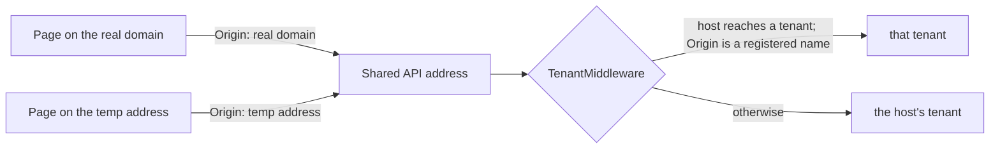

# Stage review: the registered-origin hint and tenants made with their own Admin

**Branch:** `claude-session-2026-12-14` in the app repo and in `Adventures.Foundation`. Decision: [Claude-decision-2026-11-origin-hint.md](../Claude-decision-2026-11-origin-hint.md).

## What was built

1. **`Tenancy:OriginHint` (Off or Registered, default Off).** With `Registered`, a registered browser site chooses its tenant on a shared API address; see the decision for the exact rule and threats. `TenantMiddleware` does it, `CurrentTenant.Via` carries the page address, `TenantAddressGuard` protects it, and responses get `Vary: Origin, Referer`.
2. **New tenants come with their own Admin.** `POST api/tenant` uses the site provisioner when the install has a sign-in store (`ISiteProvisioner.CreatesAccounts`), answers the sign-in to use, and the Tenants page shows it.

## Verified

Foundation, all suites: 33 new origin-hint tests (forged and unregistered origins, odd values, the exempt paths, unknown hosts, the Referer rules for reads and writes, mirrors, `Vary`, no cache growth, fail-closed without the host list, a token for another tenant, the page-address guard) and the new create-tenant tests; `Adventures.WebApi.Tests` 282, `Adventures.Identity.WebApi.Tests` 216. App: API tests 70, host tests 51; client admin 185.

## Not verified yet

Live behaviour on a host: that is the next step on the second installation (turn the setting on, create the domain's tenant, load both addresses).

## Test steps for the human

1. On the second installation set `Tenancy__OriginHint` = `Registered` on the API site (Claude does this) and restart it.
2. Admin > Tenants: remove `orderofthecross.net` as a host name of the first tenant, then **New tenant** "Order Of The Cross" on `orderofthecross.net`. The notice gives the Admin sign-in.
3. Open `https://orderofthecross.net` and `https://billkrat-001-site8.ftempurl.com`: each shows its own tenant. Sign in at the domain as Admin with the given password and change it.
