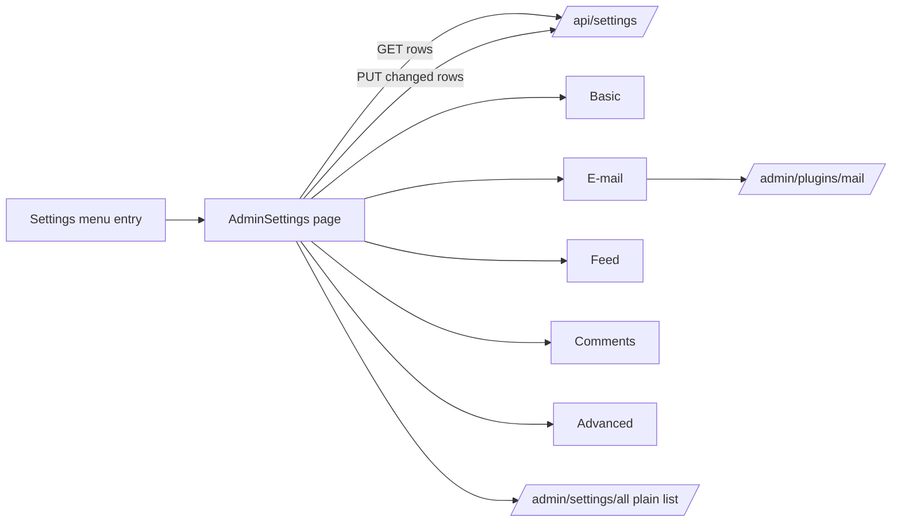

# Stage review: Settings grouped like the legacy blog (DCP c62c213c)

**Branch:** `claude-session-2026-12-14` (app repo; the Foundation branch of the same name has no change).

## What was built

Admin > Settings is now one screen with tabs, as the legacy blog groups its settings:

| Tab | Fields |
|---|---|
| Basic | Site title, Tagline, Posts per page, Language, Colour mode |
| E-mail | A link to the e-mail plug-in screen (`/admin/plugins/mail`); no site settings of its own |
| Feed | Feed items |
| Comments | Enable comments, Moderate comments, Close comments after (days) |
| Advanced | Time zone, Tracking script address |

- Each field has the right input (text, number, switch), built with the existing `adv-setting-fields` component.
- The screen reads and writes the same site-setting rows as before (`GET /api/settings?pageSize=100`, `PUT /api/settings/{id}`). Only changed settings are saved, and a setting keeps its name and description.
- No page was removed: the plain list is still at `/admin/settings/all` (icon in the page header), with its row screens beneath it.
- No server change. "Controls" has no setting in our site, so it has no tab.

## Diagram

## Verified

- New spec `admin-settings.spec.ts` (6 tests, written first): tab order, filled fields, edits survive a tab switch, only changed rows are saved, the e-mail link, the plain-list link.
- Client suites pass: admin 174, entity-ui 76, app 53; the production build succeeds. The initial-bundle budget warning (about 744 kB against 600 kB) is there without this change too.
- The button contract test caught my first tab buttons (no icon). The tabs are `role="tab"` elements with keyboard support instead.
- Not seen in a browser.

## Test steps for the human

1. `.\docs\Claude-run.ps1 -Branch claude-session-2026-12-14`, sign in as Admin, open Settings.
2. Change the site title on Basic, switch to Comments and back; the title is still edited. Save; the header shows the new title.
3. Toggle Enable comments, save, reload; the switch keeps its value.
4. Open E-mail; the link leads to the e-mail plug-in screen.
5. Use the list icon; the old plain list and its row screens still work.
