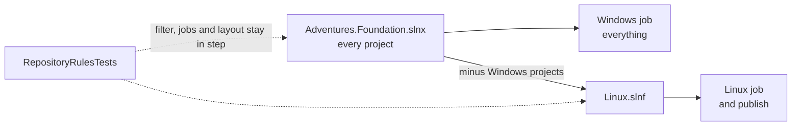

# Stage review: Foundation apps, stage 0 (2026-11-27)

Branch `claude-session-2026-12-17` in `ai-research-blog` and `Adventures.Foundation`. Plan and decisions: [foundation apps](../Claude-decision-2026-11-foundation-apps.md). Nothing has moved yet: this stage makes the repository ready to receive applications.

## What was built

1. **Layout rules** (`test/Adventures.Architecture.Tests/Support/LayoutRules.cs`): each rule takes a repository root and returns violations. `LayoutRulesTests` proves each on a made-up repository; `RepositoryRulesTests` runs them on the real one. The rules are listed in the decision record. The old "src or test" rule is replaced.
2. **Two CI jobs** (`build.yml`): Linux builds and tests `Adventures.Foundation.Linux.slnf`; Windows builds and tests the whole solution. `publish.yml` uses the Linux filter, so a desktop project cannot break a package publish.
3. **A stray file removed:** `PasswordChangeGateTests.cs` at the repository root was empty (0 bytes, added by accident on 2026-11-19). The real tests are in `test/Adventures.Identity.Tests`. A rule now refuses source files at the root.

## Verified

- Red first: against empty rules 23 tests failed. With the rules written, three failed on the real repository (root file, missing filter, CI jobs), and each passed after its fix.
- The .NET 10.0.100 SDK honours a solution filter over `.slnx`: the full filter built 58 projects, a one-project probe filter built that project and its dependency.
- Suite results and the GitHub runs are recorded in the commit and the session report.

## Not verified / limits

- `publish.yml` runs only on a version tag, so it was not run (no tag is pushed).
- No Windows project exists yet: the claim that one would break a Linux build is untested, and the first desktop view test on a GitHub Windows runner arrives with stage 2.
- The layout rules read project files as XML. A property set through an imported file (`Directory.Build.props`) would not be seen; the repository has none.
- The address rule reads `http` and `https` addresses in JSON, not bare domain names; the site-list format of stage 5 uses addresses or lives outside the repository.

## Next

Stage 1: move the browser web API to `apps/Adventures.Browser.Host`, with no change of behaviour.
