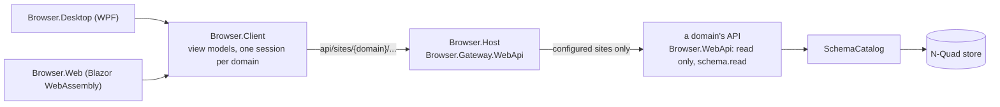

# Stage review: Foundation apps, stages 1 to 7 (2026-11-27)

Branch `claude-session-2026-12-17` in `ai-research-blog` and `Adventures.Foundation`. Built in one sitting at the human's request ("move forward with as much as you can"), one commit per stage. Plan and decisions: [foundation apps](../Claude-decision-2026-11-foundation-apps.md). How to try it: [setup and tests](../Claude-schema-browser-setup.md). **Not merged, not deployed.**

| Stage | What |
|---|---|
| 1, 2 | Browser web API and WPF app moved to `Foundation/apps`; the desktop view tests now run in CI (Windows job) |
| 3 | `SchemaCatalog`: every schema by area and name, fields, pointers, relations, "used by"; reads schema entities only |
| 4a | `Browser.WebApi`: `context`, `schemas`, `schema`; off unless `Browser:Enabled`; new right `schema.read` |
| 4b | The browser host became a gateway. The generic edit routes, the pasted-token page, its store and its user-secrets id are gone |
| 5, 6 | `Browser.Client` and the desktop schema browser (the People screens are retired) |
| 7 | The web app, sharing the same view models |

## Security: what closes and what to weigh

- **Closed:** the old browser host admitted any `TenantAdmin` token with no tenant or password-change check and could edit users and roles. It never was deployed, and that surface no longer exists.
- Domain routes go through the real pipeline: tenant by host, token-tenant check, password-change gate, rights per tenant. Host tests refuse anonymous, another right, another tenant's token and a due password change.
- Gateway: calls only configured sites, refuses plain-http site addresses and plain-http callers, follows no redirect, passes on only expected fields and its own error words, limits sign-ins per visitor, lists no site. Removing four of these guards made their tests fail.
- **To weigh:** it relays passwords; a domain's sign-in limit sees one caller.

## Verified

- Full .NET suites of both repositories after stage 7: 2237 passed, 0 failed (Windows). Foundation alone before the work: 1899.
- An end-to-end test: client library, gateway, the blog API's real pipeline and schemas (password check and rights lookup are stand-ins).
- In a browser: web app, browser API and a throwaway stand-in domain over the real schema library; domain added and kept across a reload, sign-in, list, detail, short pointer names.

## Not verified

- The desktop app has not been run by hand (its views render in tests).
- No sign-in against a real account store, a live domain or Postgres.
- Nothing deployed; the install steps are untried. The two new IIS settings files are untried on IIS.
- CI results on GitHub are reported with the push; `publish.yml` runs only on a tag.
- The Angular client was not run (unchanged).

## Your decisions

1. **The open question was taken as recommended** (the browser API asks each domain's own site; it reads no database). Say so if you meant the other.
2. Which sites to upload to, after we look at what they serve now.
