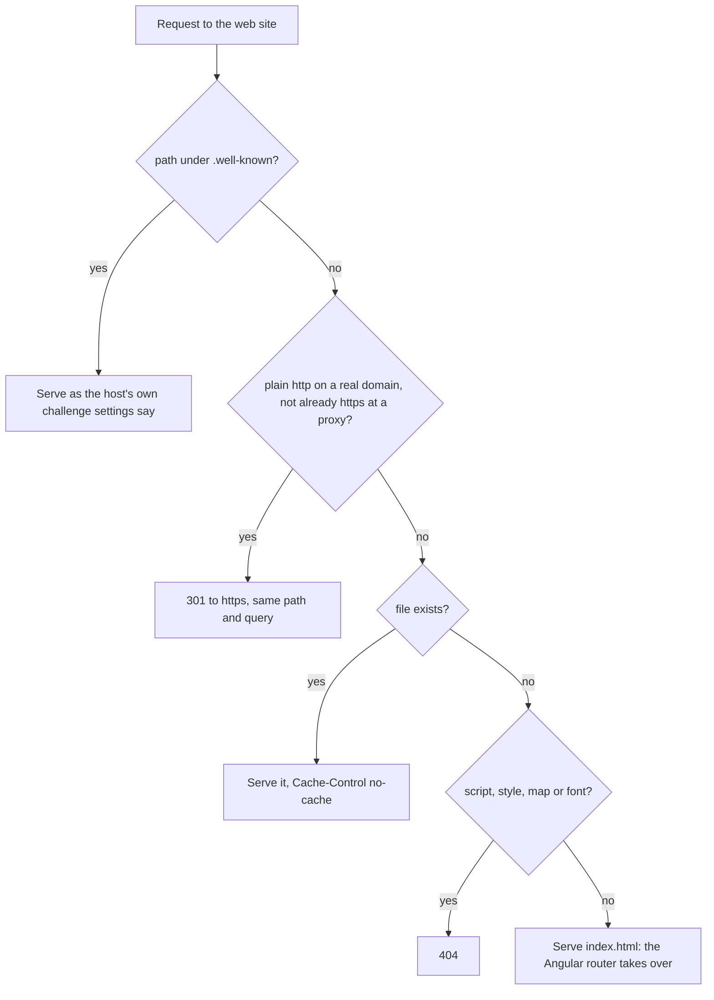

# Stage review: the web site's rules ship with the client (2026-11-27)

## Why

The live `global` web site still held an old BlogEngine install, and its 20 KB `Web.Config` was the only thing that made the Angular
client work there (deep links). The client deploy never shipped a `web.config`, so emptying the folder would have broken every refresh on
a deep link. The rules now live in the repository and travel with every build.

## What was built

- `client/ai-blog-research-ui/public/web.config`: the whole configuration of a static IIS web site, no application settings or secrets.
- `client/ai-blog-research-ui/src/app/web-config.spec.ts`: 31 tests, written first, that evaluate the rewrite rules and pin the settings.
- `.github/workflows/deploy-single.yml`: removes the file, because there the API serves the client and has its own `web.config`.
- Workspace `docs/Claude-verify.ps1`: two new checks (the page is not cached; plain http redirects to https).

## Decisions I took

- **https redirect:** applies to every address except `localhost`, `127.0.0.1` and the `*.atempurl.com`, `*.dtempurl.com` and
  `*.ftempurl.com` temporary addresses. An installation on a real domain needs its certificate first (install guide).
- **Threats the headers address:** content sniffing (`nosniff`), clickjacking (`X-Frame-Options: SAMEORIGIN`), address leaking to other
  sites (`Referrer-Policy`), unused device features (`Permissions-Policy`). No Content-Security-Policy: it needs its own tested stage.
- **No Strict-Transport-Security** on the web site: browsers hold it for months, so it should be a deliberate choice.
- **Caching:** every file is revalidated. Simple and never stale; long caching of the hashed files can come later.
- **Missing assets are a 404** instead of the application page, which is what the old site did.

## Verified

- Client tests: all projects pass, including the 31 new ones (they failed before the file existed). Production build copies the file
  beside `index.html`.
- Server test projects that the CI runs: pass.
- IIS Express with URL Rewrite, the built client, and the host's real `.well-known/acme-challenge/web.config`: deep links 200 with the
  application page (also `.aspx` and dotted addresses), `no-cache` and the four headers present, `about.md` served as Markdown, missing
  assets 404, `/web.config` 404, the challenge file 200 over plain http, the redirect keeps path and query, no redirect when a proxy says
  https.

## Not verified

- Nothing is deployed. SmarterASP's IIS may differ from IIS Express (a server-level setting could clash).
- A real certificate renewal with the redirect in place (the folder is exempt and was tested locally).
