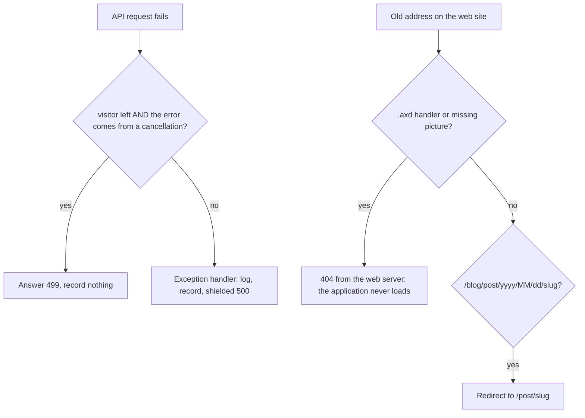

# Stage review: less noise in the error log (2026-11-27)

## Why

The production exception log showed database "SSL handshake" errors and route errors (NG04002). The server logs for 11-26 showed the
database ones came from visitors who left while the API was opening its connection. The route errors in the logs of 11-20 and 11-26 were
50 reports, 46 of them old BlogEngine `.axd` addresses and 4 other old blog addresses.

## What was built

- Foundation `Adventures.WebApi`: `AbandonedRequests` and `UseShieldedErrors()` (used by `UseAdventuresPreamble`, so both hosts).
- Foundation `TenantCorsPolicyProvider`: the list of trusted sites is no longer read under one visitor's cancellation. **A fault found
  on the way:** when that read was cancelled and the driver wrapped the cancellation, the provider took it for an unreadable store and
  kept only the configured origins for ten seconds, so registered sites could be refused for other visitors.
- Client `web.config`: `.axd` addresses and missing pictures answer 404.
- Client routes: a post address behind a blog's own name redirects like the plain one.

## Verified

- Tests written first and seen failing. Foundation 1,859 tests, app server tests 246 and client tests 539 pass.
- A running host: a real abandoned request records nothing, a real fault on the same host is still recorded.
- IIS Express with the built client: the `.axd` addresses and the missing picture are 404; deep links, files and the certificate folder
  behave as before.

## Not verified / limits

- Nothing is deployed; it goes live when the session branch is merged.
- The older database entries (10-24, 11-08, 11-20) were not traced to log lines. If one of them was a real outage, it would still be
  recorded after this change, because the visitor was waiting.
- The 2016 post in the example was not found on the live API under that address, so its redirect ends on a "not found" post.
- Old feed readers asking for `syndication.axd` get 404; they are not redirected to the new feed.
