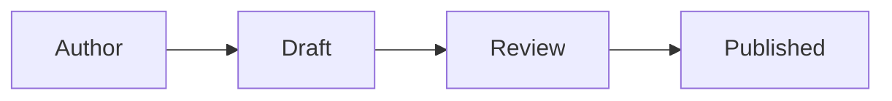
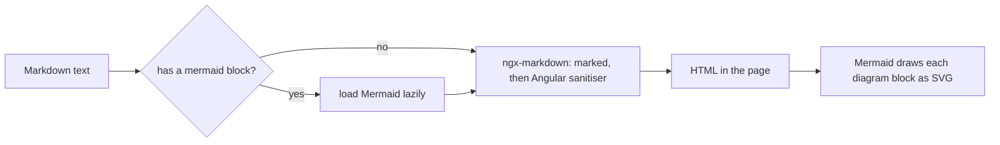

The stage reviews that explain this project's code are full of diagrams. Until now a diagram in a post showed up as a block of source text. This post explains how a fenced `mermaid` block now becomes a drawing, in the reader and in the editor's Preview, and what that cost.

## What you write

A diagram is a fenced code block whose language is `mermaid`:

````markdown

````

Press **Preview** in the editor, or publish the post, and the block is drawn. The same text works in both places because they now share one renderer.

## How it works



- **One renderer.** `app-markdown-content` wraps [ngx-markdown](https://github.com/jfcere/ngx-markdown), which uses `marked` underneath. The public reader and the editor preview both use it, so what you preview is what a visitor sees.
- **Mermaid is loaded only when needed.** The library and its diagram types are large. The component looks for a fenced `mermaid` block first and imports the library only then. A post without a diagram never downloads it. On the live site a plain post loads about ten scripts and the post with the diagram about thirty.
- **Still sanitised.** The HTML goes through Angular's sanitiser, so a post cannot run scripts, event handlers or unsafe links in a visitor's browser. Mermaid itself runs at its strict security level.
- **Theme.** Diagrams are drawn in the dark or light theme that is active when the post is shown.

## Things we learned

- ngx-markdown expects a global `mermaid` object and does not load it for you. The lazy import sets that global just before the first render.
- One of its optional imports (`marked-katex-extension`) stops the Angular dev server from loading the page, because the development bundler cannot resolve it. Installing that small package fixes it; the production build was never affected. Math (KaTeX) is not turned on.
- The first version of the unit test tried to draw a real diagram and failed: Mermaid needs real layout measurements, which the test browser cannot give. The test now replaces Mermaid with a stand-in and checks only the decision that matters, loading it for a diagram and not for plain text.
- `npm audit` now reports two low-severity advisories that reach the browser, through Mermaid's use of KaTeX. We do not use math, and the fix needs Mermaid 12, which ngx-markdown does not allow yet.

## Known gaps

- A diagram that does not parse shows Mermaid's own error drawing instead of your source text.
- A diagram keeps the theme it was drawn in until the post is shown again.
- This is a renderer, not an editor with a toolbar. The text area with Preview stays; a fuller editor is on the backlog.
