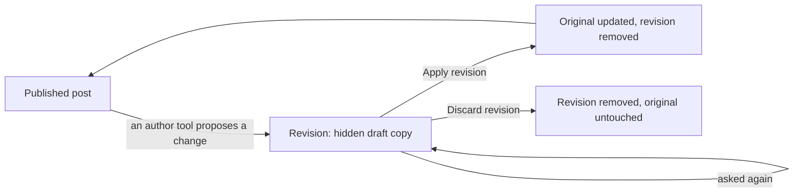

A published post is what visitors read, so nobody, human or AI tool, should be able to change it halfway. A **revision** is how a change is proposed instead: a hidden copy of the post that carries the changes, which an administrator reviews and then applies or throws away. This is also how Claude sends review summaries and corrections: the change arrives as a revision and you decide.

## The life of a revision

1. **Propose.** A tool with the drafts-only author scope (Claude, through the MCP server's `propose_revision` tool) names a published post and the fields to change. It can only do this for a post it wrote itself, and only for a post that is already published. A draft is simply edited.
2. **The copy.** The server creates a new post that is a copy of the original, with the changes applied and everything you did not mention carried over. It is a draft, never public, and it remembers which post it revises (the **Revision of** field).
3. **Asking again updates the same revision.** There is never more than one open revision per post: a second proposal updates the open one rather than piling up copies.
4. **Review in the admin.** In **Admin > Posts** the revision is a row of its own with the same title as the original, shown in italics, and the **Revision of** column names the original. Open it to read the new text.
5. **Apply or discard.**
   - **Apply revision** (the check icon) copies the revision's **title, content, description, comments setting, categories and tags** onto the original and removes the revision. The original keeps its **address, date and author**, so links to it keep working and nothing is republished or re-dated.
   - **Discard revision** (the cancel icon) removes the revision and leaves the original exactly as it was.

## Why you cannot publish a revision

A revision is not a post: if it were published you would have two public posts with one title. So its editor offers only Apply and Discard, never Publish. In the list, the **Published** switch on a revision row is greyed out, and hovering it explains why. The post to publish or unpublish is always the original.

## What the safeguards are

- A tool can only create drafts and revisions. Publishing, applying and discarding are administrator actions in the admin.
- Applying is one step with one outcome, and a revision whose original has since been deleted refuses to apply and asks you to discard it.
- A revision is a draft, so it is hidden from the public site.

## What is not built yet

- There is no side-by-side comparison of a revision against the published text. For now you read the revision's content and compare it by eye.
- Only the post's own fields are revised. Slug, date and author never change through a revision.

## Where this lives in the code

The rules are in the post business layer (`PostBll`: apply, discard, mark a revision), the proposal path is `ContentAuthoring.ProposeRevisionAsync`, the MCP tool is `propose_revision`, and the admin buttons come from the posts controller as server-supplied actions. The list's locked switch is the generic grid's `toggleLockedField`.
