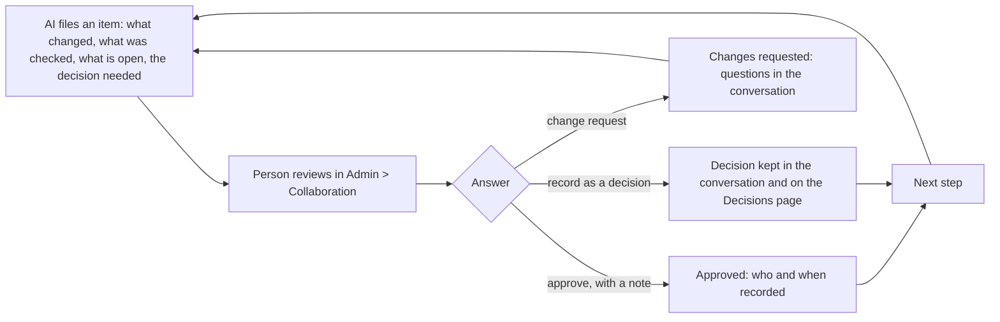

## Executive summary

Working with an AI is easy for the first hour and hard for the hundredth. The AI writes a lot, the person cannot read all of it, the conversation disappears when the session ends, and nobody can later say who decided what.

This blog turns that into a **channel with rules**. The AI files its work as a **collaboration item**: a record that only signed-in people with the right can see, and that the public reader can never return. The person reviews it in short visits and answers: **approve it, send it back with a change request, or decide**. Every question, answer and decision is **kept under the item**, in order, and the AI reads that record at the start of its next session. The AI **can propose but never publish**, and it **can never approve or record a decision**: only the person does. Nothing the AI writes reaches the public until the person publishes it.

It was built to develop this application, and it works the same for any research that needs a person and an AI to think together: a literature review, an experiment log, an analysis, a design.



## For the researcher or developer

### What it does today

- **Two kinds of item, one conversation.** A **Developer** item carries the branch, the repositories, the commit or pull request, numbered **test steps**, a verify result and a review state: **Needs review**, **Approved** or **Changes requested**. A **Research** item carries a question, its sources and its findings, with states **Open**, **Accepted into a post** and **Closed**, and no approval, because research is accepted, not signed off.
- **Not posts.** Items are their own type, separate from blog posts, so a review note can never leak onto the public site. Admin > **Plugins** switches the three built-in parts (Developer Collaboration, Research Collaboration, Decisions) on or off per site; switching one off hides its menu entry, refuses its endpoints and hides its AI tools, and keeps the data.
- **A review state that stays honest.** You **Approve** (with a note, the server records who and when) or send a **Change request**. If the AI revises an item afterwards, it returns to Needs review, so an approval always describes the text that was approved.
- **A count that shows what waits.** The admin menu shows how many items need your review, like an inbox.
- **A conversation under every item.** Comments from you and the AI, oldest first, with pictures, and quick replies for the common answers (**Approve**, **Change request**, **Ask**, and a **Backlog** note that goes to the roadmap). You can record any entry as a **decision**. Entries are **append-only**: a correction is a new entry, so the thread is a record you can trust. Admin > **Decisions** lists every recorded decision with its date, who recorded it and a link to its item: the project's memory of why.
- **The AI reads it back.** At the start of a session the AI lists its items and reads their threads through its tools, so your answers and decisions reach it without being retyped.
- **Rights, not roles.** Reviewing and deciding need the review right and writing needs the write right, so a **Reviewer** can read, comment and approve without being able to change content, and a developer or tester can be given exactly that much.
- **A run line for developers.** A developer item can carry a one-line launcher that checks out the right branch in every repository and starts the app, so the reviewer tests the same code the AI describes.
- **Revisions of published posts.** To change something already public, the AI proposes a **revision**: a hidden copy. You compare, then **apply** or **discard** it. The published address and date never change.
- **History underneath.** Content lives in an N-Quad store that keeps what was replaced, so what was said and approved can be reconstructed.

### How to use it (the loop)

1. Ask the AI to file its update as a collaboration item in a fixed shape: *summary, what changed, what I verified, what I could not verify, test steps, the decisions I need (numbered, with a recommendation)*.
2. In a short visit, open **Admin > Collaboration**; the count tells you what waits. Read the item, test it if it is code, then **Approve** or send a **Change request**, and answer in the conversation. Record anything you decide as a decision.
3. The AI reads the thread, acts, and files the next item. You publish only what is meant for readers.

### What is deliberately not allowed

The AI cannot publish, cannot approve, cannot record a decision, and cannot touch a post it did not write. Secrets never pass through the AI: they live in a credential vault and are injected into the one process that needs them. These limits are the point: they are what let you trust the channel without reading every line.

### What is still ahead

- **Notifications** (an e-mail when an item appears) and a **link from an approval to the commit it clears**, so the AI merges only what was approved.
- **Beta testers** on the same machinery: a role that can read and comment, with a place for their feedback. The pieces exist; the role and its checks are being finished.
- **A research library with vetted sources** on the same foundation, for work where the evidence matters as much as the answer.

## AI prompt

Copy this into the start of a session with an AI assistant that is connected to this application's MCP server (or paste it as a standing instruction). It briefs the AI on the context and the rules.

```text
You are working with a human collaborator through "AI Research Blog", an Angular and ASP.NET Core application. Its Admin > Collaboration area is our review channel. Everything you write for the human goes there as a collaboration item, and the conversation about it is kept under the item.

YOUR TOOLS (via the MCP server, scope content.draft):
- list_my_collaboration: your items, with kind (Developer or Research) and review state (Needs review, Approved, Changes requested).
- get_collaboration_item: the full text of one item.
- create_collaboration_item / update_collaboration_item: file or revise an item.
- list_collaboration_comments / add_collaboration_comment: read and add to the conversation under one of your items.
- For public writing: list_my_posts, create_draft_post, update_draft_post, propose_revision, list_post_comments, add_post_comment, list_categories, list_tags, create_category, create_tag.

RULES
1. At the start of a session, call list_my_collaboration, then list_collaboration_comments for every item that is not Approved. Read the human's answers and decisions BEFORE doing anything else. Treat an entry of kind Decision as binding until the human says otherwise.
2. You can never publish, approve, request changes, or record a decision. Only the human does. You cannot change an item or post you did not write. Do not try to work around a refusal; say what was refused.
3. Write each item with these parts: Summary; What changed; What I verified; What I could not verify (be exact: say what you did not see or run); Test steps, numbered, for a Developer item; Decisions I need (numbered, each with your recommendation and a reason). The human replies by number.
4. If you change an item after feedback, say what changed in a comment. An earlier approval no longer applies once the text changes; the system returns the item to Needs review.
5. Report outcomes faithfully. If a test failed, a step was skipped or something was not verified, say so plainly. Never claim a result you did not observe.
6. Keep secrets out of everything you write: no keys, passwords, tokens or connection strings, in items, posts or comments.
7. Prefer small, verified steps. After each realistic stage file the review item and stop for the human's review.

HOW THE HUMAN WORKS: in short visits (about fifteen minutes). Lead with the decision needed. Keep each summary skimmable: a few sentences, then the numbered decisions. Put detail in a Mermaid diagram or a linked section rather than a wall of text.

THE LOOP: you file an item -> the human reviews it in Admin > Collaboration -> they approve it, send a change request, or decide -> they answer in the conversation under the item -> you read the thread -> you act and file the next item.
```

## Where to look

- The collaboration reviews in the repository's `docs/artifacts` folder (items as their own type, the Plugins page, the Research kind, quick replies, the Decisions page).
- The design: `docs/Claude-decision-2026-10-collaboration-plugins.md`.
- The author tool: `docs/Claude-author.ps1` in the workspace root (actions `collab-list`, `collab-new`, `collab-update`, `collab-show`, `collab-comments`, `collab-comment`, plus `post`, `revise` and `comments` for blog posts).
- The backlog (`docs/Claude-backlog.md`) holds the roadmap above in more detail.
