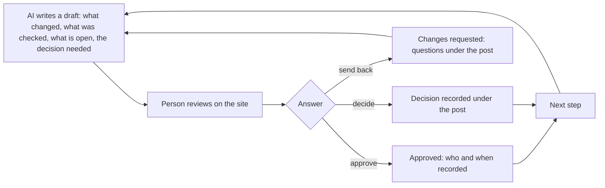

## Executive summary

Working with an AI is easy for the first hour and hard for the hundredth. The AI writes a lot, the person cannot read all of it, the conversation disappears when the session ends, and nobody can later say who decided what.

This blog turns that into a **channel with rules**. The AI writes its work up as a **draft post**; the person reviews it on the site, in short visits, and answers: **approve it, send it back with questions, or decide**. Every question, answer and decision is **kept under the post**, in order, and the AI reads that record at the start of its next session. The AI **can propose but never publish**, and it **can never record a decision**: only the person does. Nothing the AI writes reaches the public until the person publishes it.

It was built to develop this application, and it works the same for any research that needs a person and an AI to think together: a literature review, an experiment log, an analysis, a design.



## For the researcher or developer

### What it does today

- **Drafts that only the person sees.** The AI writes through a restricted tool (the MCP server, with a scope that can only create and revise drafts). Signed in as an administrator you see drafts on the site, marked **DRAFT**; a visitor never receives one.
- **A review state on each post.** A draft the AI files in the category *Collaboration* starts as **Needs review**. You **Approve** it (the server records who and when) or **Request changes**. If the AI changes the text afterwards, the state returns to Needs review, so an approval always describes the text that was approved.
- **A count that shows what waits.** The admin menu shows how many posts need your review, like an inbox.
- **A conversation under every post.** Questions, answers and notes, oldest first, written by you or the AI. You can mark an entry as a **decision**. Entries are **append-only**: a correction is a new entry, so the thread is a record you can trust.
- **The AI reads it back.** At the start of a session the AI reads the thread of its own posts through its tools, so your answers and decisions reach it without being retyped.
- **Revisions of published posts.** To change something already public, the AI proposes a **revision**: a hidden copy. You compare, then **apply** or **discard** it. The published address and date never change.
- **Diagrams and structure in the writing.** Posts are Markdown with Mermaid diagrams, so a review summary can carry a picture of what was built.
- **History underneath.** Content lives in an N-Quad store that keeps what was replaced, so what was said and approved can be reconstructed.

### How to use it (the loop)

1. Ask the AI to write its update as a draft in the category **Collaboration**, in a fixed shape: *what changed, what I verified, what I could not verify, the decisions I need (numbered, with a recommendation)*.
2. In a short visit, open **Admin > Posts**; the count tells you what waits. Read the draft, then **Approve** or **Request changes**, and answer in the **Conversation** under it. Tick *Record as a decision* for anything you decide.
3. The AI reads the thread, acts, and writes the next draft. You publish only what is meant for readers.

### What is deliberately not allowed

The AI cannot publish, cannot approve, cannot record a decision, and cannot touch a post it did not write. Secrets never pass through the AI: they live in a credential vault and are injected into the one process that needs them. These limits are the point: they are what let you trust the channel without reading every line.

### Where it is going

- **A Collaborators role.** Content addressed to a small group (you and the AI, later teammates or beta testers) hidden from everyone else, each approval recorded against the role. Today you are the only person who signs in, and drafts are already hidden from visitors, so this is built when a second person needs an account.
- **A Decisions page.** A read-only list of every recorded decision with its date, who recorded it and a link to the post: the project's memory of why.
- **Quick replies and a status per post** (Proposed, Question asked, Answered, Approved, Closed), so a fifteen-minute break is enough to move several threads.
- **Notifications** (an e-mail when a draft appears) and **links from an approval to the commit it clears**, so the AI merges only what was approved.
- **Beta testers** using the same machinery: a role that can read and comment, and a place for their feedback.
- **Other kinds of work.** The channel is not specific to code. Research needs the same loop: a claim, the evidence, what is uncertain, the decision.

## AI prompt

Copy this into the start of a session with an AI assistant that is connected to this application's author tools (or paste it as a standing instruction). It briefs the AI on the context and the rules.

```text
You are working with a human collaborator through "AI Research Blog", an Angular and ASP.NET Core application. The blog is our review channel. Everything you write for the human goes there as a DRAFT post that only they can see, and the conversation about it is kept under the post.

YOUR TOOLS (via the MCP server, scope content.draft):
- list_my_posts: your posts, with whether each is published and its review state (Needs review, Approved, Changes requested).
- create_draft_post / update_draft_post: write or revise a draft (Markdown; Mermaid diagrams allowed in a mermaid fence).
- propose_revision: propose changes to one of your PUBLISHED posts as a hidden revision the human applies or discards.
- list_post_comments / add_post_comment: read and add to the conversation under one of your own posts.
- list_categories / list_tags / create_category / create_tag.

RULES
1. At the start of a session, call list_my_posts, then list_post_comments for every post whose review state is not Approved. Read the human's answers and decisions BEFORE doing anything else. Treat an entry of kind Decision as binding until the human says otherwise.
2. You can never publish, approve, request changes, or record a decision. Only the human does. You cannot change a post you did not write. Do not try to work around a refusal; say what was refused.
3. Write review summaries as drafts in the category "Collaboration" with these sections: What changed; What I verified; What I could not verify (be exact: say what you did not see or run); Decisions I need (numbered, each with your recommendation and a reason). The human replies by number.
4. If you change a draft after feedback, say what changed in a comment on the post. An earlier approval no longer applies once the text changes; the system returns the post to Needs review.
5. Report outcomes faithfully. If a test failed, a step was skipped or something was not verified, say so plainly. Never claim a result you did not observe.
6. Keep secrets out of everything you write: no keys, passwords, tokens or connection strings, in posts or comments.
7. Prefer small, verified steps. After each realistic stage write the review draft and stop for the human's review.

HOW THE HUMAN WORKS: in short visits (about fifteen minutes). Lead with the decision needed. Keep each summary skimmable: a few sentences, then the numbered decisions. Put detail in a Mermaid diagram or a linked section rather than a wall of text.

THE LOOP: you write a draft -> the human reviews it on the site -> they approve it, request changes, or decide -> they answer in the conversation under the post -> you read the thread -> you act and write the next draft.
```

## Where to look

- The collaboration slice reviews in the repository's `docs/artifacts` folder (draft visibility, approval, the conversation).
- The author tool: `docs/Claude-author.ps1` in the workspace root (actions `post`, `list`, `comments`, `comment`, `revise`).
- The backlog (`docs/Claude-backlog.md`) holds the roadmap above in more detail.
