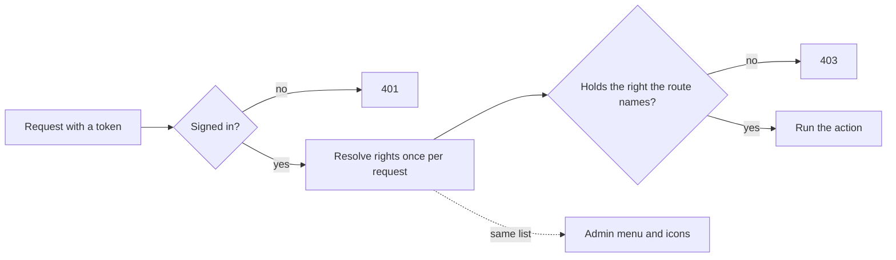

For a long time every admin screen asked one question: **are you an administrator?** That is easy to build and hard to live with. The day you want an Editor who can write posts but not see users, you either make them an administrator or build a second rule by hand. This post describes how the admin side of this project now asks a more precise question, and how a test keeps it that way.

## The idea: a role is a bundle of rights

A **right** is one small thing a person may do, named like `posts.edit.any`, `users.manage` or `collaboration.review`. A **role** (Administrator, Editor, Reviewer...) is only a named bundle of rights. The code never asks "is this person an Editor?"; it asks "does this person hold `posts.edit.any`?". Change what the Editor role contains and every screen follows, with no code change.

There are 23 rights today, kept in one catalog. The Administrator holds all of them, so nothing changed for the person running the site.

## What changed in S2

1. **Every admin route names its right.** A controller says which right each action needs (read, create, update, delete), and an action with its own purpose, such as purging the exception log, names a stricter one.
2. **The answer is a plain HTTP status.** No sign-in gives 401. Signed in without the right gives 403. A route that names no right at all is refused, so forgetting is safe.
3. **The menu follows rights.** The server builds the admin menu, so an Editor never sees Users or Roles. This is a convenience, not the protection: typing `/admin/users` still gets a 403.
4. **The icons follow rights.** Add, Edit and Delete on a post or page appear only if you hold the matching right.
5. **The profile shows "What you can do".** The person sees the same list the server uses.

## The part worth copying: a test that fails for the next mistake

The risk with any scheme like this is the route someone adds next month and forgets to guard. So there is a guard test that walks every controller in the API and fails if:

- a route has no right and is not marked public,
- a route still uses the old administrator-only rule,
- a named right does not exist in the catalog,
- an admin menu entry names no right.

Adding an unguarded route breaks the build, which is a much better time to find out than after a release.

## A seam for later: conditions

Rights are resolved through one small interface, and a second hook (`IRightCondition`) can add a condition, for example "only while the subscription is active". Nothing uses it yet, but it is where per-plan limits would plug in without touching any controller.

## What is deliberately not done

- **Own versus any.** The Editor may edit any post but delete none, because the "own posts only" rights need the stored post to check the author. That is the next slice.
- **Existing stored roles.** A seed file applies once and cannot overwrite a value already stored, so a changed default (the Reviewer gaining permission to comment) ships as a small startup upgrade step. Worth knowing before you change a default in your own copy.

## What to reuse

If you are building something similar: keep rights in one catalog, resolve them once per request, make "no right named" mean "refused", drive the menu from the same rights, and write the guard test on day one.
