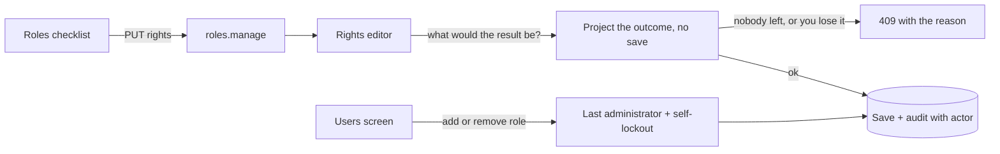

Once an application lets an administrator change who may do what, the most dangerous button on the screen is the one that removes the last person who can change it. This post covers how the Roles and Users screens in this project make role changes safe, and what the checks are.

## Three kinds of change, three protections

**Assigning or removing a role for a person (Users screen).**
- The change is recorded against the **acting user**. It used to be recorded as "system", which is no audit at all.
- You cannot remove **your own** assignment of a role that holds `users.manage` or `roles.manage` (the self-lockout guard).
- The existing **last administrator** rule still applies: the last holder cannot be removed.

**Changing the rights of a role (Roles screen).** A saved role shows every right as a checkbox with its description and a Save rights button. The server refuses a save that would:
- include a right that is not in the catalog (nothing unknown reaches storage),
- take away your own ability to manage users and roles,
- leave nobody holding that ability.

A refusal comes back as a 409 with the reason in plain words, and the screen shows those words beside the button.

**Reading it.** Everything on the screen comes from the server (the catalog and the descriptions), so a new right shows up in the checklist without a client change.

## The design choice worth copying: ask "what would happen?" before saving

The rights editor does not save and then check. It asks the resolver to **project** the result of the change without writing anything, then decides. That keeps the rule in one place (the same resolver that answers every request) and makes the refusals easy to test: give it a change, look at the projection, expect an exception.

One honest exception: when the data names nobody at all today (a fresh store), the "someone must still hold it" check is skipped, because there is no one to protect yet.

## Why a role matrix test too

Alongside this came a **role matrix test**: four named test people (editor, reviewer, developer, nobody) are checked against the admin routes to confirm what each can and cannot do. When a right moves between roles, the matrix says exactly what changed for whom. Test people are created on a test store, never on real data.

## What to reuse

1. Record the acting user on every permission change.
2. Make the self-lockout and last-holder checks part of the same code path as the change, not a UI nicety.
3. Project, then decide.
4. Return the reason in words; the person fixing it is a human.

## Status

Built and covered by tests (the guards and the editor, and the matrix). A hands-on click-through of the checklist is still on the human's list, so treat the screen behaviour as "tested in code, not yet by a person" until that is ticked.
