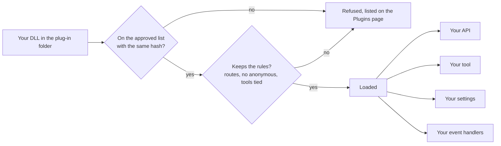

# Write your first plug-in

You can extend this app without touching its code. A plug-in is a separate project that builds to one DLL; you drop the DLL in a folder, put its fingerprint on a list, restart the site, and it appears on the **Plugins** page. This post builds a small one from nothing. The finished version lives in the Foundation repository as `test/Adventures.MEF.SampleWebPlugin`.

## What a plug-in can do today

A plug-in can bring any mix of these, each tied to the plug-in so that switching the plug-in off removes all of them for that blog:

- **An API:** its own controller under `/api/plugins/<your key>/`.
- **A tool:** a description of one of your API calls that the MCP server and any client can discover through `GET /api/tools`.
- **Settings:** fields on the plug-in's **Customize** screen, stored per blog.
- **Event handlers:** code that runs when something happens (an exception was recorded, a post was published), or a say before something happens (a post is about to be published).

It cannot yet add its own admin screens, menu entries or widgets; those come with the widget zones.



## 1. The project

Create a class library that targets .NET 10, and reference the Foundation projects by path (nothing here is published to a package registry). The sample's project file is the model:

```xml
<Project Sdk="Microsoft.NET.Sdk">
  <PropertyGroup>
    <TargetFramework>net10.0</TargetFramework>
    <EnableDynamicLoading>true</EnableDynamicLoading>
  </PropertyGroup>
  <ItemGroup>
    <FrameworkReference Include="Microsoft.AspNetCore.App" />
    <PackageReference Include="System.Composition.AttributedModel" Version="9.0.0" />
  </ItemGroup>
  <ItemGroup>
    <ProjectReference Include="..\path\to\Adventures.MEF\Adventures.MEF.csproj" />
    <ProjectReference Include="..\path\to\Adventures.Tools\Adventures.Tools.csproj" />
  </ItemGroup>
</Project>
```

`EnableDynamicLoading` makes the build write a `.deps.json` next to your DLL, which the host uses to find your private dependencies.

## 2. The module: who you are, and what you add

Every plug-in exports one `IPluginModule`. It says what the plug-in is (a **key**, which must be unique) and registers what it adds:

```csharp
[Export(typeof(IPluginModule))]
public sealed class HelloPluginModule : IPluginModule
{
    public const string Key = "hello";

    public PluginDefinition Definition => new(
        Key, "Hello plug-in", "Says hello and counts exceptions.", "0.1.0", 900,
        [new PluginSettingDefinition("Greeting", "Greeting", "What the hello endpoint says.",
                                     PluginSettingKind.Text, "hello from my plug-in", 80)]);

    public void ConfigureServices(IServiceCollection services)
    {
        services.AddSingleton<ExceptionCounter>();
        services.AddPluginEventHandler<ExceptionRecordedEvent, CountExceptions>(Key);
        services.AddSingleton<IAppTool>(new AppTool(
            "hello_tool", "Says hello and how many exceptions this plug-in heard about.",
            """{ "type": "object", "properties": {} }""",
            "content.draft", "GET", "api/plugins/hello/say", [Key]));
    }
}
```

The `Greeting` setting appears on the plug-in's **Customize** screen with no screen code from you. The last argument of `AppTool` ties the tool to your plug-in key. The tool's scope (`content.draft` here) is the scope a caller's token must carry to see it; use one your callers already hold.

The counter both parts share is an ordinary class (register it as a singleton, as above):

```csharp
public sealed class ExceptionCounter
{
    private int _seen;
    public int Seen => Volatile.Read(ref _seen);
    public void Heard() => Interlocked.Increment(ref _seen);
}
```

## 3. The API

```csharp
[ApiController]
[Route("api/plugins/hello")]
[Authorize]
public sealed class HelloController(IPluginSettings settings, ExceptionCounter counter) : ControllerBase
{
    [HttpGet("say")]
    public async Task<IActionResult> Say(CancellationToken ct) =>
        Ok(new { greeting = (await settings.GetAsync(HelloPluginModule.Key, ct))["Greeting"], heard = counter.Seen });
}
```

Three rules apply, and the host checks them before it accepts your plug-in:

1. Every route starts with `api/plugins/<your key>/`. You cannot shadow or extend the app's own routes.
2. Nothing is anonymous. `[AllowAnonymous]` on a plug-in controller or action refuses the plug-in.
3. Every tool carries your key (so it disappears with the plug-in) and calls a route under your prefix.

While the plug-in is switched off for a blog, its endpoints answer 404 there.

## 4. An event handler

```csharp
public sealed class CountExceptions(ExceptionCounter counter) : IPluginEventHandler<ExceptionRecordedEvent>
{
    public Task HandleAsync(ExceptionRecordedEvent e, CancellationToken ct)
    {
        counter.Heard();   // e.Message is already scrubbed of secrets and shortened
        return Task.CompletedTask;
    }
}
```

Handlers run after the fact and off the request, one after another. A slow or broken handler is logged and given up on; it never slows or breaks a visitor's request. An event raised from inside a handler is ignored, so a handler that fails cannot trigger itself (a Slack notifier whose failure is recorded as an exception would otherwise loop).

To step in before something happens, implement `IPluginEventInterceptor<PostPublishingEvent>` and register it with `AddPluginEventInterceptor`. Returning `InterceptResult.Cancel("reason")` keeps the post a draft and shows the reason to the person who tried to publish. A broken or slow interceptor counts as allowing, so a plug-in bug cannot lock the site.

## 5. Build, fingerprint, drop in

Build the project. From the output folder, take **only your DLL and its `.deps.json`** (and any private dependency DLLs of your own). Do not copy the app's libraries such as `Adventures.MEF.dll`; the host already has them, and every DLL in the plug-in folder that is not on the approved list is reported as refused.

Compute the SHA-256 of each DLL you copied (PowerShell):

```powershell
(Get-FileHash .\HelloPlugin.dll -Algorithm SHA256).Hash
```

Put it on the approved list, a file named `approved-plugins.json` in the plug-in folder:

```json
{ "HelloPlugin.dll": "3F2A...your hash..." }
```

A plug-in is code that runs with the app's rights, so the host loads a DLL only if its hash is on this list, and loads exactly the bytes it checked. That is why the list is the control: review the code, then approve the hash. If you rebuild, the hash changes and the list must change with it.

Finally point the host at the folder with the setting `Plugins:Directory` (in `appsettings.json`, or the environment variable `Plugins__Directory` on the host) and restart the site. A new DLL is picked up at start-up; there is no hot reload.

## 6. See it work

- Open **Admin > Plugins**. Your plug-in is listed; **Customize** edits its settings.
- If something was refused, the **Not loaded** section on the same page gives the file and the reason (not on the approved list, hash differs, a route outside the prefix, an anonymous endpoint, a tool not tied to the plug-in). The same text is a warning in the site log at start-up.
- Sign in, call `GET /api/plugins/hello/say`, and switch the plug-in off: the endpoint answers 404 and the tool leaves `GET /api/tools` for that blog. Switch it on again and everything returns.

## Things worth knowing

- **Per blog:** switches, settings and event delivery are per tenant. A plug-in that is off for one blog hears nothing for that blog.
- **Secrets:** events carry plain values only, never an exception object, and exception messages are scrubbed. A credential belongs in a setting of kind `PluginSettingKind.Secret`: it is encrypted at rest (AES-256-GCM with the host's key ring), shown on the Customize screen only as "set" and never sent back, and replaced or cleared there. A plain `Text` setting is stored readable, so never put a credential in one.
- **Isolation:** a plug-in loads in its own context, cannot replace the app's libraries, and its private dependencies are hash-checked too.
- **Tests:** the sample shows both sides. `PluginWebRulesTests` checks the rules; the host tests load the real DLL and check the API, tool, settings, per-blog switch and event handler.

If you build something with this, the most useful feedback is which event you reached for that does not exist yet.
