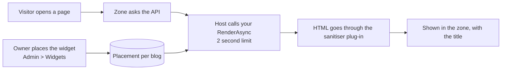

# Write your first widget

A widget is a box on the public site: a tag cloud, a text box, a list of categories. The owner puts widgets in four **zones** around the content (header, left, right, footer) on the **Admin > Widgets** screen. This post builds a widget as a C# class, with no Angular and no change to the app, and shows what the host does with it. If you have not built a plug-in yet, read [Write your first plug-in](/post/write-your-first-plug-in) first: a widget travels inside a plug-in.

## What a widget is

A widget is one class with one method. It receives the zone it was placed in and its settings, and returns HTML. What the widget *is* (its key, its title, the settings an owner can fill in) is declared as data next to it, the same way a tool is.



## 1. The widget

```csharp
public sealed class HelloNoteWidget : IWidget
{
    public Task<string> RenderAsync(WidgetContext context, CancellationToken ct) =>
        Task.FromResult($"<p>{WebUtility.HtmlEncode(context.Settings["Text"])}</p>");
}
```

`WidgetContext` carries three things: `Zone` (`"header"`, `"left"`, `"right"` or `"footer"`, so a widget can look different in a narrow place), `Settings` (the values the owner entered, with your defaults filled in; only settings you declared are ever present), and `Tenant` (the blog it is shown for). Encode anything an owner or a visitor typed: the host sanitises the HTML as a safety net, but your widget should not depend on it.

A widget can ask for services in its constructor like any other class (the sample's tag cloud takes `IPublicContent` to read the tags), so it can read the blog's content without any glue.

## 2. Register it from your plug-in module

In the plug-in's `ConfigureServices` (see the first plug-in post), one line registers the widget and declares its settings:

```csharp
services.AddWidget<HelloNoteWidget>(Key, new WidgetDefinition(
    "hello.note", "Hello note", "Shows a line of text in a zone.",
    [new PluginSettingDefinition("Text", "Text", "The line to show.", PluginSettingKind.Text, "hello from my widget", 120)]));
```

Two things to know:

- **The widget key must start with your plug-in key and a dot** (`hello.note` for the plug-in `hello`). The host refuses a plug-in whose widget key could shadow another widget, such as the built-in `text-box` or `tag-cloud`, and says why on the Plugins page.
- **The widget belongs to your plug-in.** Switch the plug-in off for a blog and the widget vanishes from that blog's pages and from the choices on the Widgets screen. Placements are kept, shown as "not available", and come back when you switch the plug-in on again.

The setting form on the Widgets screen is built from your declaration, with the same kinds as a plug-in's Customize screen: text, one value per line, a switch, a number. You write no screen code.

## 3. What the host does with it

- **Only the four zones.** A widget does not choose where it appears; the owner does.
- **A two-second limit.** If your widget is slower, it is left out of the page and a warning is logged. The page never waits for it.
- **If it throws, it is left out** and logged. One broken widget never breaks a page or another widget.
- **The HTML goes through the sanitiser plug-in**, like post HTML: scripts, event handlers, frames and unsafe addresses are removed. If the owner has switched sanitising off for the blog, your HTML is shown as written, which is their choice and their risk.
- **Empty means no box.** Return an empty string when you have nothing to show (no tags yet, say) and no empty frame is drawn.
- **At most 100,000 characters.** A larger answer is dropped, because cutting HTML in half would break the page.
- **Per blog.** What a visitor sees depends on that blog's placements, switches and settings.

## 4. Styling, honestly

The sanitiser removes CSS classes it does not know. The blog's own widget classes (the tag cloud's pills, for instance) are always kept. For your own classes, the owner adds them on the **HTML sanitising** Customize screen (**Extra allowed CSS classes**); names used by the app's own interface are refused, so content cannot dress up as the app. Inline `style` with safe properties (colour, size, spacing) always works.

What does not exist yet: a way for a plug-in to ship its own stylesheet. Until it does, a plug-in's classes have nothing to style them, so use inline styles or plain, semantic HTML that inherits the site's look.

Links to this site (an address starting with `/`) navigate inside the app without a page reload; other links behave normally.

## 5. Test it

The sample plug-in's tests show the three layers:

- **The widget on its own:** build the class, call `RenderAsync` with a `WidgetContext`, assert on the HTML. Include a case where the text has markup in it.
- **The rules:** `PluginWebRules.Validate` runs the same checks the host runs (the widget key prefix, tools and routes); call it on your module's services in a test and expect `null`.
- **Through the real host:** the host tests copy the built DLL into a plug-in folder with its hash on the approved list, place the widget for one blog through `IWidgetPlacements`, and read the public zone, then switch the plug-in off and read it again.

## 6. Ship it

Build, copy your DLL (and its `.deps.json`) into the plug-in folder, put its SHA-256 on `approved-plugins.json`, restart the site. Open **Admin > Widgets**: your widget is in the list. Choose a zone, click **Add**, click **Edit** to set its title and settings, and look at the public site. On a phone only the header and footer zones are shown.

## What is not there yet

Drag and drop on the Widgets screen (it uses up and down buttons today), widgets written in Angular for richer interaction, plug-in stylesheets, a short cache for widget output, and most of the widgets BlogEngine.NET had (author list, month list, search, newsletter). Each is a small addition to a contract that is now in place; the most useful feedback is which one you reached for first.
